<p align="center">
  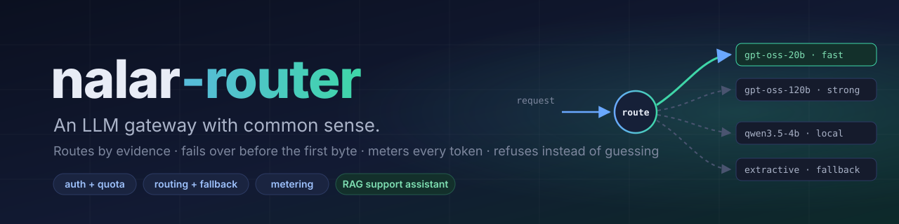
</p>

<p align="center">
  <a href="https://nalar-router.onrender.com"></a>
</p>

<p align="center">
  <a href="https://github.com/fauziridwan1709/nalar-router/actions/workflows/ci.yml"></a>
  
  
  
  
  <br>
  
  
  
  
  
  
  
  
  
</p>

<p align="center">
  <a href="docs/assets/demo.mp4?raw=true">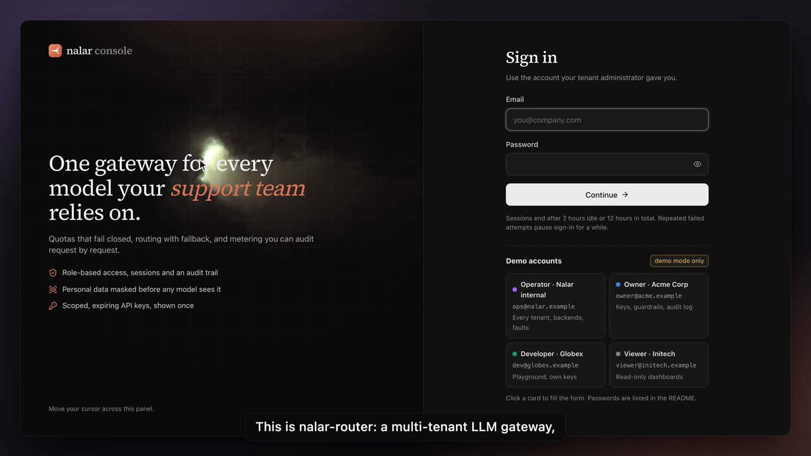</a>
  <br>
  <sub><b>Product tour (6 min, voice-over and subtitles, <a href="docs/assets/demo.mp4?raw=true">download MP4</a>):</b> the sign-in page and what each demo account's plan and quota allow, then every console page as Acme Corp's owner: a playground request with personal data masked and a real fallback, API keys, usage, cost, reliability, logs with routing decisions, quotas, guardrails, access, the audit log, backends and evaluations.</sub>
</p>

---

**nalar-router** is a small, multi-tenant LLM gateway with one packaged capability on top: a **customer-support assistant**. It answers from a knowledge base, reports the intent it detected, and **refuses rather than guesses** when it isn't sure.

*Nalar* is Indonesian for "reason" or "common sense". On every request the gateway makes two calls with real consequences: which model is worth paying for, and whether to answer at all. Both are made from evidence, recorded, and visible in the console.

> **Try it:** open the [live console](https://nalar-router.onrender.com), sign in with one of the demo accounts listed on the sign-in page (for example `ops@nalar.example`), and send a message in the Playground. You can watch the answer stream in along with the model that served it, whether fallback fired, what was retrieved, the intent and confidence, tokens, latency and cost. On the **Backends** page you can break a backend on purpose and watch the router fall back. The service runs on Render's free tier, so the first request after 15 minutes idle takes about a minute.

## Contents

- [Features](#features)
- [Results](#results)
- [Architecture](#architecture)
- [Screenshots](#screenshots)
- [Quick start](#quick-start)
- [Configuration](#configuration)
- [Demo tenants](#demo-tenants)
- [Console sign-in, roles and API keys](#console-sign-in-roles-and-api-keys)
- [API](#api)
- [Evaluation](#evaluation)
- [Testing](#testing)
- [Deployment](#deployment)
- [Project structure](#project-structure)
- [Design decisions and trade-offs](#design-decisions-and-trade-offs)
- [Next development: improving retrieval](#next-development-improving-retrieval)
- [Dataset and credits](#dataset-and-credits)

## Features

### Gateway

- **Streaming:** Server-Sent Events, per-tenant API keys (stored only as SHA-256 hashes), strict input validation, and stable error codes.
- **Monthly quota per tenant (tokens and requests):** each request pre-authorises its tokens in one atomic transaction, so two concurrent requests can't both spend the last tokens. The quota check fails closed: if it errors, the request gets 503 and no model is called. A request over quota gets 429 with `Retry-After`.
- **Metering:** every request and every backend attempt is stored with the model, tokens (and whether they came from the provider or were estimated), latency, time to first token, estimated cost and outcome.
- **OpenAI-compatible endpoint:** `/v1/chat/completions` and `/v1/models` for raw use, tested with the official OpenAI SDK, with an `x_router` block that explains routing.

### Routing and fallback

- **Four backends:** Groq `gpt-oss-20b` (fast), Groq `gpt-oss-120b` (strong), Qwen3.5-4B running locally on Apple MLX, and an extractive fallback that always works.
- **Reasoning effort is `low` for both Groq models, for now.** The fast and strong tiers differ in model size, not in how hard they think. The playground's Reasoning switch (and `include_reasoning`) only controls whether the reasoning text is returned; gpt-oss reasons, and is billed for it, either way. Raising strong to `medium` is a next step, to be measured first (REPORT §3).
- **Rules you can defend:** the router respects the tenant's plan, defaults to the cheap model, and escalates to the strong one when a query-complexity score reaches 0.5. The score adds up weighted signals: length, ambiguous retrieval, several questions, reasoning cues, multi-step structure, constraints, code, math. Each decision is stored as `{rule, reason, chain, signals}` with the score and the signals that fired.
- **Three router modes:** `auto` is that heuristic (free, instant). `auto-smart` has the fast model classify the message first (one metered call, about 0.5 s), which catches hard questions in plain words and keeps long simple ones on fast. `auto-cascade` starts every support request on fast and moves to strong before anything is streamed, but only on doubt a stronger model could remove. Measured side by side in [REPORT §3](docs/REPORT.md#3-routing).
- **What `mock` is:** the fourth backend, `mock` (model `extractive-kb-v1`), is not a language model and not a test double. It is the gateway's degraded mode: it streams the best-matching knowledge-base answer word for word, with the intent retrieval voted for, in the same header-then-answer format a model writes. It costs nothing, needs no network or key, and can't be rate-limited, so it is the last link of every route chain: when every real model fails, the customer still gets a grounded answer instead of an error. Its token counts are estimates (labelled `estimated`), its speed is set by `MOCK_TOKEN_DELAY_MS`, and fault injection works on it like on any backend. Without a Groq key it serves every request, which is why the app runs with zero setup. On chat completions it has no KB answer to give, so it echoes the request and says no model was used.
- **Fallback:** triggered by an error, no first token within the timeout, the total timeout, or unusable model output. Every attempt is recorded, and a per-backend circuit breaker skips backends that keep failing.
- **One commit point:** fallback can happen only before the first byte reaches the client. Two models' outputs are never spliced into one answer.
- **Fault injection** per backend (`error`, `hang`, `garbage`, extra latency), so fallback can be demonstrated on demand.

### Support assistant

- **Retrieval:** BM25 over 2,160 Bitext KB entries, with typo correction. It reaches 94.7% intent accuracy on its own, and a query takes 0.14 ms.
- **Response:** the answer, the detected intent, the retrieved entries, and a confidence score made of three parts (retrieval vote, lexical coverage, the model's own estimate).
- **Validated output:** the model must emit a JSON header (intent and confidence) before any text streams. If the header is bad, the router falls back to the next backend.
- **No raw `{{placeholders}}`:** Bitext answers are templates. The model keeps placeholders and the gateway fills them in while streaming, so the LLM never types a phone number, URL or order id. Values come from, in order:
  1. the customer's own message ("order 12345")
  2. the tenant's **company profile** (phone, hours, website)
  3. default UI labels
  4. a natural phrase ("your order number")
- **Refusal:** short off-topic messages are refused before any model is called ($0). The model can also mark a message `unknown`. Low confidence leads to a hand-off message instead of a guess.

### Governance and security guardrails

- **PII masking:** emails, phone numbers, payment cards (Luhn-checked), national IDs (NIK, SSN), IBANs (mod-97-checked) and IP addresses are found before anything leaves the gateway.
  - Each value is replaced with a placeholder such as `{{Customer Email}}` in the text that retrieval and the model provider see.
  - On the support path the gateway restores the value in the answer after generation, the same way it fills `{{Order Number}}`. Customers read a natural reply, and the provider never saw the value. Card, ID and bank numbers come back only as "the card ending in 1111".
  - Per-tenant policy: **mask** (default), **block** (`422 pii_detected` before admission, no model call, no quota spent) or **off**, and which types to detect. Owners change it on the Guardrails page; every change is audited.
  - Values are never logged, metered or put in trace events. Only types and counts (`email:1,card:1`) are stored with the request.
  - Detectors are conservative so order and invoice numbers survive. Across all 3,553 messages in the dataset slices there were 0 false positives. Personal names are not detected; that needs an NER model and is a known gap.
- **Access control:** four roles checked on the server for every console route; tenant isolation with 404 parity; members and the permission matrix on the Access page.
- **Audit logging:**
  - Sign-ins and failed attempts, API key creation and revocation, PII policy changes, quota resets, fault injection, and operators reading another tenant's data.
  - The Audit log page filters by event and exports CSV, with cells guarded against formula injection.
- **Error handling:** one error shape everywhere, with the least detail that still helps the caller (see [How it's secured](#how-its-secured)).

### Console

The console follows the Claude Console's layout: a top bar with search (⌘K command palette), notifications and documentation; a sectioned sidebar (Build & configure, Monitor, Security & data, Platform) with the account menu at the bottom; and centred pages with filter chips ("Tenant All ▾"), stat cards and chart cards with a chart/table toggle. It is dark by default, with a light theme. Controls come from Meta's open-source [Astryx](https://astryx.atmeta.com/) design system, icons from Lucide; type is Inter with Source Serif 4 for headings. Charts follow the dataviz method (validated palette, one axis, a tooltip and a table view on every chart) and animate in once. Motion is off under `prefers-reduced-motion`.

- **Sign-in:** a dark split page with the cursor-following spark trail (WebGL2, off for touch and reduced motion). It lists four seeded accounts, one per tenant and one per role. See [Console sign-in, roles and API keys](#console-sign-in-roles-and-api-keys).
- **Dashboard:** a greeting with *Get API key* and *Open playground*, three headline cards (requests with the change against the day before, token volume, PII-masked requests), the backends as cards, and resource shortcuts.
- **Playground:** *Build your request* on the left: the endpoint (support answer or chat completions, with its `POST` path next to the title), Form or Code, tenant, routing, prompt version, a `stream: true|false` toggle, reasoning, the system prompt (managed by the gateway for support, editable for chat) and the user message. On the right: templates for each endpoint, or the answer with an inspector. The inspector has tabs for Overview (incl. PII guardrail), Trace, Routing, Retrieval (support only) and Raw, which shows the exact SSE stream or JSON body an API client would receive. History and *Get code* sit in the header.
- **Monitor:**
  - **Usage:** tokens in and out, requests; token usage stacked by backend or tenant; requests by outcome.
  - **Cost:** total, per 1,000 requests and per 1M tokens; cost stacked by backend or tenant; cost by tenant.
  - **Reliability:** answer rate, p95, fallback rate and rejections; a **Pareto** of why requests weren't answered (or of intents) with the 80% line; latency and fallback trends; traffic share. *Run sample traffic* sends 15 real requests.
  - **Logs:** every metered request, filterable by tenant, outcome, fallback and personal data, with a **route strip** and a drawer holding the routing decision and each attempt.
  - **Quotas:** stat cards (tokens, requests, spend, tenants needing attention, the reset date), then one row per tenant with token and request meters, spend and a status. "Rejecting requests" shows as soon as a request is refused with 429, even below 100%, because each request reserves its prompt plus a minimum answer. A row opens to show what's left, model tiers, the company profile and outcomes.
- **Security & data:**
  - **Guardrails:** PII policy, a live detector tester, and each built-in control with the file that enforces it.
  - **Access:** members and the role matrix.
  - **Audit log.**
- **Platform:**
  - **Backends:** health, pricing, timeouts, breakers and fault injection.
  - **Evaluations:** committed eval runs.
- **Feature guide:** a spotlight tour on first sign-in, replayable from the sparkle button; notifications for quotas above 80% and backends that are down.

## Results

Thirty held-out Bitext cases and five out-of-domain prompts were run end to end through the real gateway. Answer quality was scored by an LLM judge (gpt-oss-120b, scale 1–5) and by ROUGE-L.

| configuration | intent accuracy | judge (1–5) | p50 latency | p50 first token | cost per 1k requests |
|---|---|---|---|---|---|
| **groq-fast · prompt v2** (default) | **100%** | 4.47 | 0.74 s | 0.61 s | **$0.092** |
| groq-strong · prompt v2 | 100% | **4.53** | 0.79 s | 0.65 s | $0.185 |
| groq-fast · prompt v1 | 96.7% | 4.50 | 0.74 s | 0.58 s | $0.078 |
| local-qwen (MLX) · prompt v2 | 100% | 4.43 | 5.27 s | 3.34 s | $0 |

- **Default model:** the 120b model isn't more accurate on this task and costs twice as much. That is the evidence for routing to the fast model by default and escalating only on hard inputs.
- **Refusals:** every configuration refused 5/5 out-of-domain prompts, and none wrongly refused any of the 30 in-domain cases.
- **Hard-case probe:** 8/8 inputs (prompt injection, angry, multi-intent, typo'd, Indonesian) behaved as expected after one fix that the probe itself uncovered.
- **Real fallback:** during the eval Groq slowed down, both Groq backends timed out, and local Qwen served the request. All three attempts are recorded.
- **No raw placeholders:** answers showing raw `{{placeholders}}` dropped from **15/30 to 0/30** with prompt v3 and gateway-side rendering. Intent accuracy is unchanged, and the cost is +7% tokens. See the report for the honest judge numbers.
- **Token estimates:** my chars/4 estimate runs 6–17% *above* what the provider reports. That is the safe direction for pre-authorising quota.

Every run, with links to its raw output, is in **[docs/EVALUATION.md](docs/EVALUATION.md)**. The same runs are charted on the console's Evaluations page. The full analysis, including what these numbers *don't* show, is in **[docs/REPORT.md](docs/REPORT.md)**.

## Architecture


### Request lifecycle (with fallback)

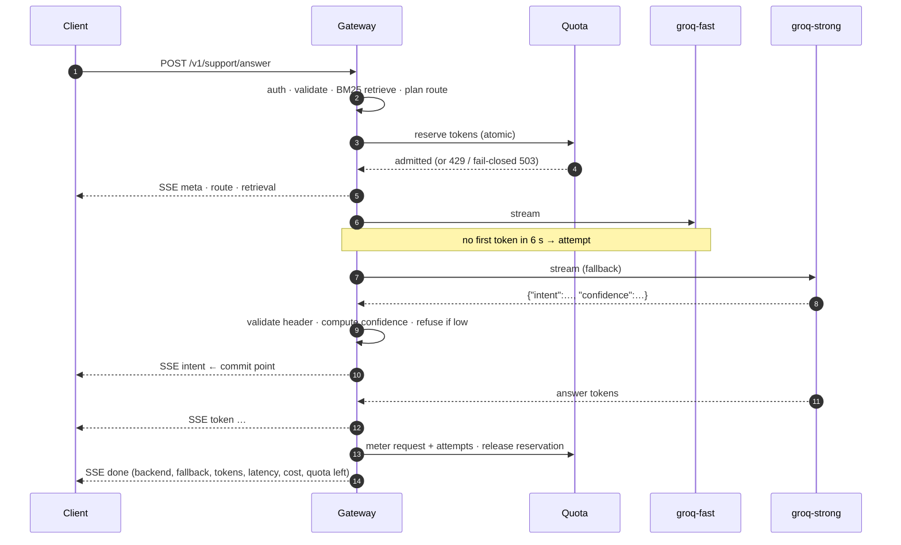

### Code structure: Clean Architecture

Both apps follow Robert C. Martin's **[Clean Architecture](https://blog.cleancoder.com/uncle-bob/2012/08/13/the-clean-architecture.html)**, with folders named after its four circles. Source code dependencies point inward only (the Dependency Rule), and a `tests/architecture.test.ts` in each app fails the build when an import breaks it.

| circle | gateway (`apps/gateway/src`) | console (`apps/console/src`) |
|---|---|---|
| Enterprise Business Rules | `entities/`: routing policy, complexity, breaker, quota rule, metering math, PII, BM25, RBAC, error catalog | `entities/`: API types, formatting, access, quota standing, playground reducer |
| Application Business Rules | `use-cases/`: capability path, support, chat, fallback executor, console and key management, plus `ports/` | `use-cases/`: the `ConsoleApi` port |
| Interface Adapters | `interface-adapters/`: `controllers/http`, `presenters` (SSE, OpenAI wire format, errors), `gateways` (SQLite, LLM providers) | `interface-adapters/gateways/http`: fetch, CSRF, SSE parsing |
| Frameworks & Drivers | `frameworks/`: the Express app, the SQLite driver | `frameworks/ui`: React pages, components, hooks |
| Main | `main/`: config, composition root, process | `main.tsx` |

The circles, the request flow through ports, and the two places where the code is pragmatic rather than textbook are in [docs/ARCHITECTURE.md §5](docs/ARCHITECTURE.md#5-code-layers).

More diagrams (the routing decision tree and the data model) are in **[docs/ARCHITECTURE.md](docs/ARCHITECTURE.md)**.

## Screenshots

**Dashboard.** ⌘K search, sectioned sidebar, headline cards, backends and resources.

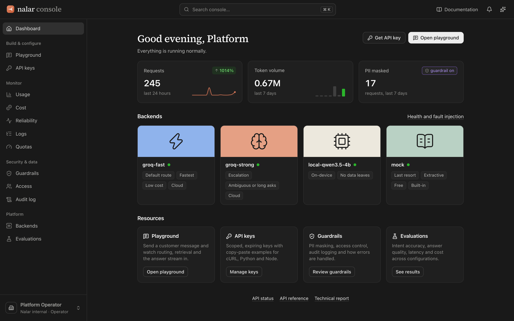

| Sign-in, with the cursor spark trail | Playground: templates, streamed answer, PII masked and restored |
|---|---|
| 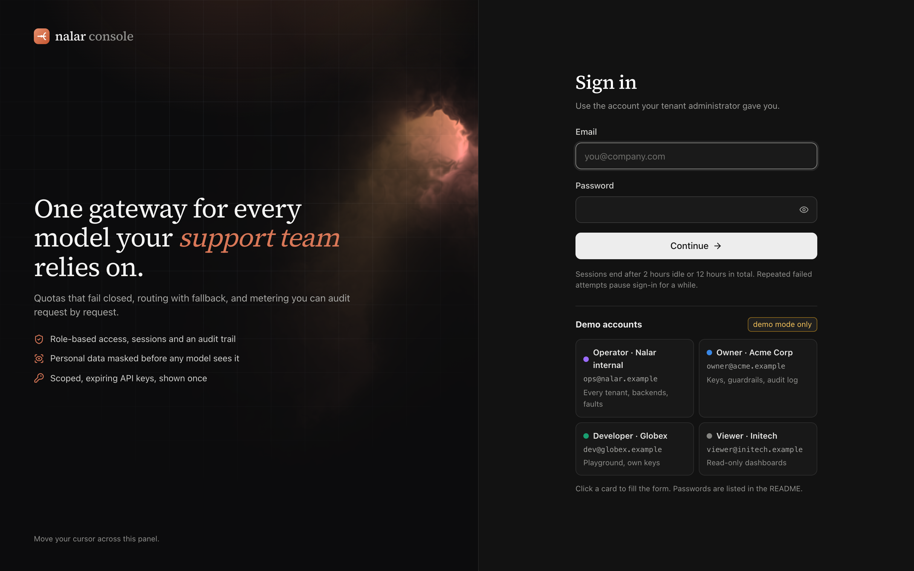 | 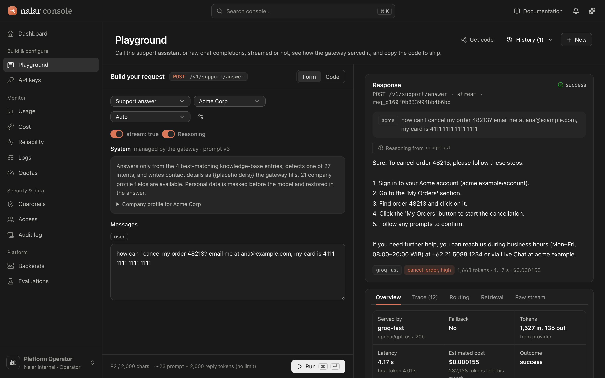 |
| **Reliability: Pareto of unanswered causes** | **Guardrails: PII policy and detector** |
| 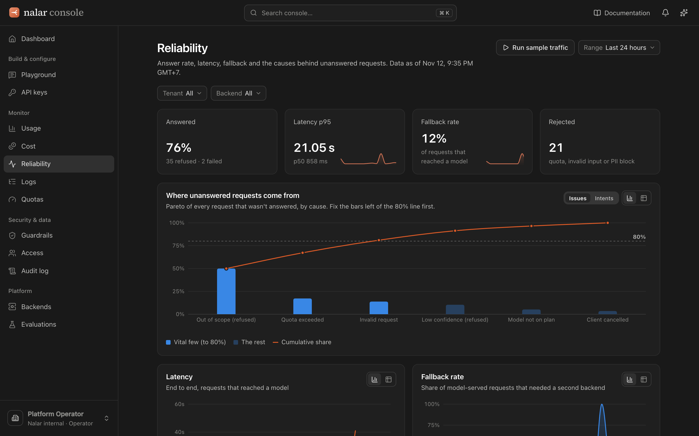 | 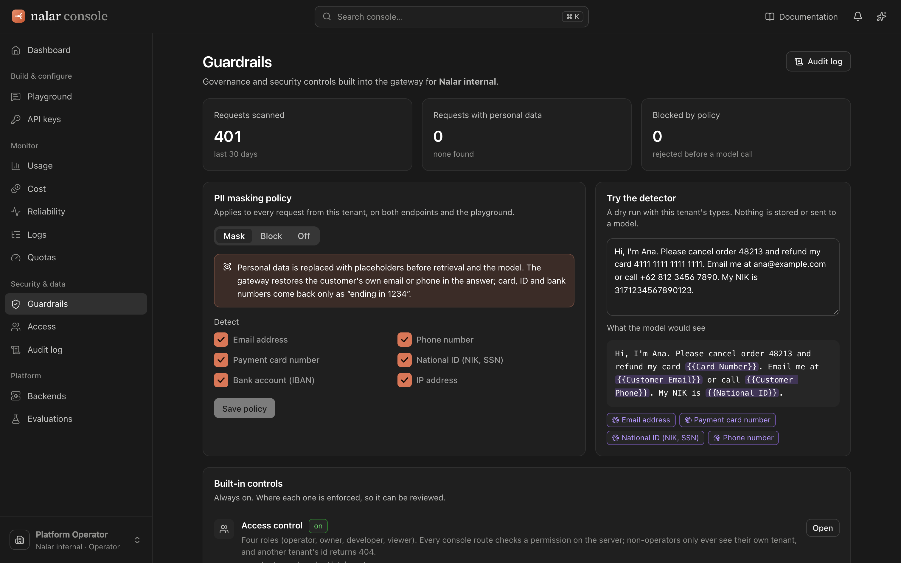 |
| **Usage, grouped by backend** | **Logs: route strip and PII column** |
| 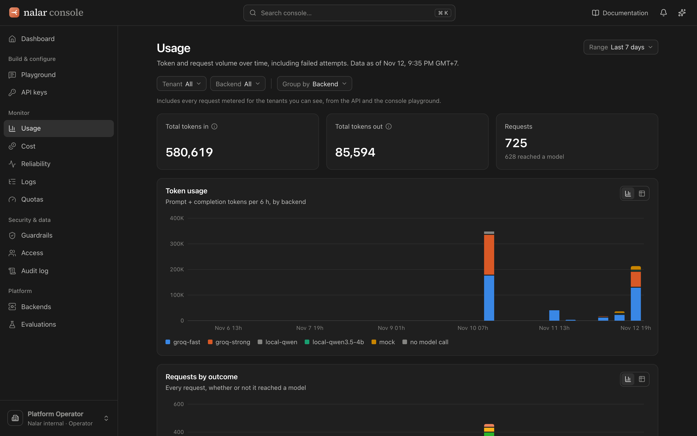 | 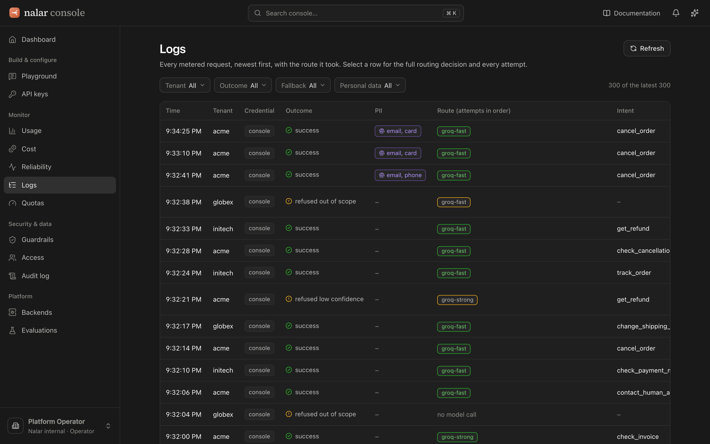 |
| **API keys and quickstart** | **Cost, light theme** |
| 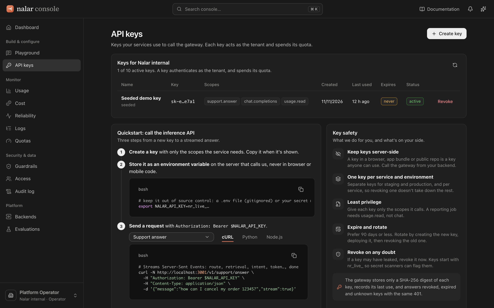 | 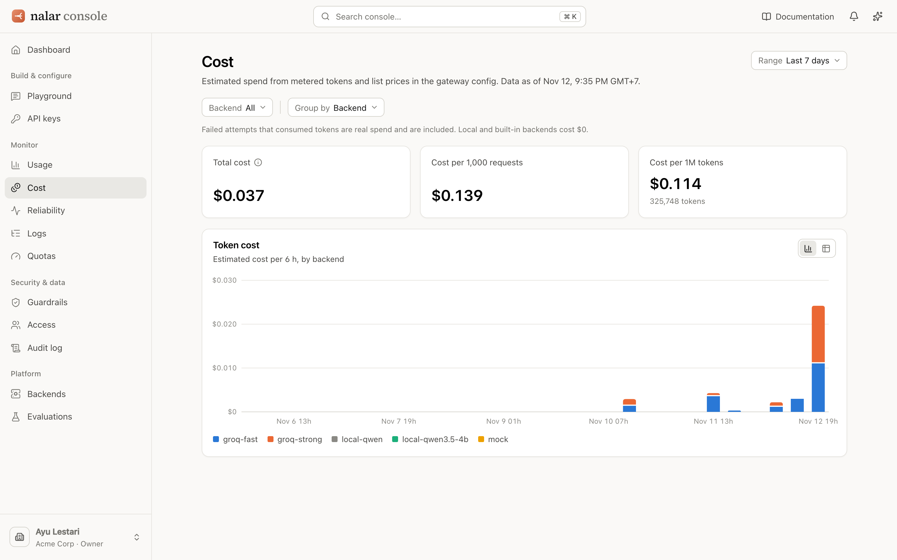 |
| **Quotas** | **Backends and fault injection** |
| 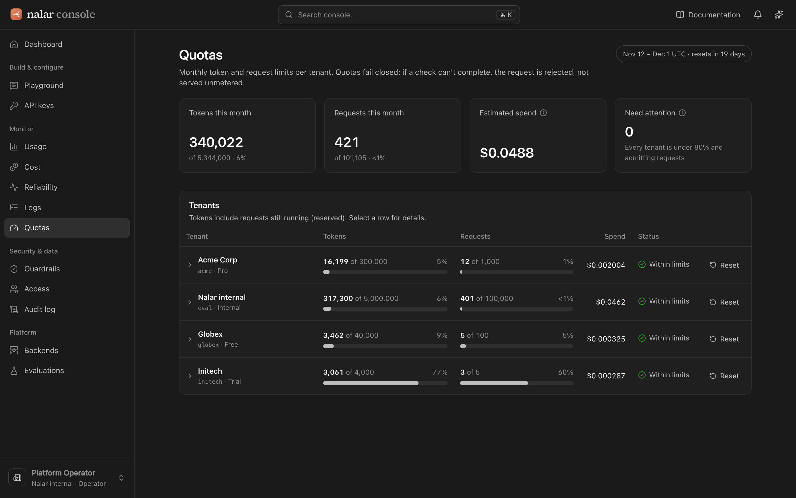 | 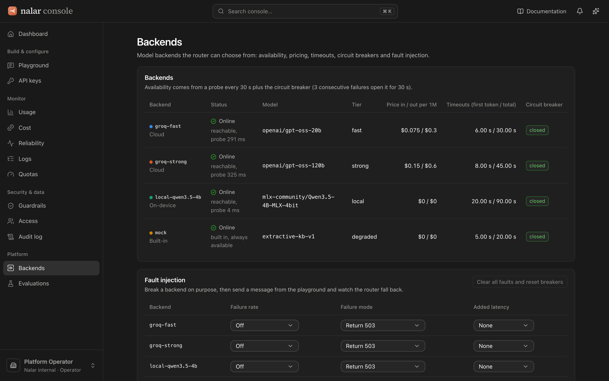 |
| **Evaluations: committed eval runs** | |
| 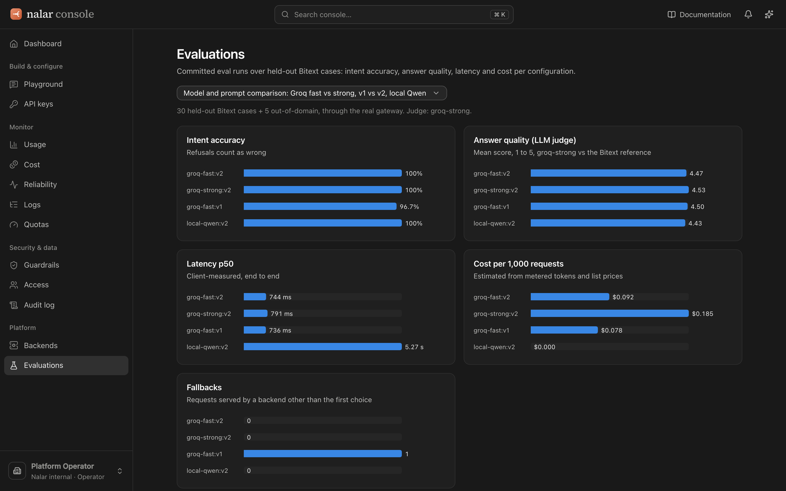 | |

## Quick start

### Prerequisites

- **Node.js ≥ 22.13** (the gateway uses the built-in `node:sqlite`; Node 24 is recommended)
- **A Groq API key** (free at [console.groq.com/keys](https://console.groq.com/keys)). Optional: with no key, the built-in mock backend (extractive answers from the KB) serves every request, so the whole app runs with zero setup.
- **Optional:** Apple Silicon with Python 3.10+, for the local MLX model

### 1. Install

```bash
git clone https://github.com/fauziridwan1709/nalar-router.git
cd nalar-router
npm install            # installs every workspace
cp .env.example .env   # optional: set GROQ_API_KEY for real models
```

### 2. Run

```bash
npm run build          # gateway (tsc) + console (vite)
npm start              # http://localhost:3000 serves the API and the console
```

Open http://localhost:3000 and sign in with one of the demo accounts listed on the sign-in page (for example `ops@nalar.example`), or see [Demo accounts](#demo-accounts).

For development, run these in two terminals:

```bash
npm run dev            # gateway with reload on :3000
npm run dev:console    # Vite on :5173, proxies /v1 /admin /api to :3000
```

### 3. Optional: local model on Apple MLX

```bash
python3 -m venv ~/.venvs/mlx && ~/.venvs/mlx/bin/pip install mlx-lm
~/.venvs/mlx/bin/mlx_lm.server --model mlx-community/Qwen3.5-4B-MLX-4bit --port 8080
echo "LOCAL_LLM_ENABLED=true" >> .env
```

To use Ollama instead, set `LOCAL_LLM_BASE_URL=http://localhost:11434/v1`, `LOCAL_LLM_MODEL=qwen3.5:4b` and `LOCAL_LLM_EXTRA_BODY={"reasoning_effort":"none"}`.

### 4. Try it

```bash
curl -N http://localhost:3000/v1/support/answer \
  -H 'authorization: Bearer sk-acme-demo-7f3a9c' -H 'content-type: application/json' \
  -d '{"message":"how do I cancel order 123?"}'
```

### 5. Optional: rebuild the dataset slices

The generated slices in `data/` are committed. To regenerate them, download the [Bitext CSV](https://huggingface.co/datasets/bitext/Bitext-customer-support-llm-chatbot-training-dataset) to `data/raw/bitext.csv` and run:

```bash
npm run prepare-data   # seeded and deterministic
```

## Configuration

All settings are environment variables, read from `.env` at the repo root (or from the Render dashboard). Defaults live in [`apps/gateway/src/main/config.ts`](apps/gateway/src/main/config.ts).

| variable | default | purpose |
|---|---|---|
| `GROQ_API_KEY` | — | Enables `groq-fast` and `groq-strong` |
| `GROQ_FAST_MODEL` / `GROQ_STRONG_MODEL` | `openai/gpt-oss-20b` / `openai/gpt-oss-120b` | Model ids |
| `GROQ_TTFT_TIMEOUT_MS` | `6000` (fast), `8000` (strong) | Fall back if there's no first token by then |
| `LOCAL_LLM_ENABLED` | `false` | Enables `local-qwen3.5-4b` |
| `LOCAL_LLM_BASE_URL` | `http://127.0.0.1:8080/v1` | Any OpenAI-compatible server (MLX, Ollama, vLLM…) |
| `LOCAL_LLM_MODEL` | `mlx-community/Qwen3.5-4B-MLX-4bit` | |
| `GROQ_CONTEXT_WINDOW` | `131072` | Tokens in + out per call for both Groq models |
| `LOCAL_LLM_CONTEXT_WINDOW` | `8192` | Tokens in + out per call for the local model: a laptop budget, below Qwen's native window |
| `LOCAL_LLM_API_KEY` | unset | Bearer token for a tunnelled local server ([Local model on the deployed URL](#local-model-on-the-deployed-url)) |
| `LOCAL_LLM_EXTRA_BODY` | `{"chat_template_kwargs":{"enable_thinking":false}}` | Provider-specific request fields |
| `LOCAL_LLM_TTFT_TIMEOUT_MS` | `20000` | |
| `ROUTE_LONG_QUERY_TOKENS` | `60` | Messages longer than this escalate to the strong tier |
| `ROUTE_AMBIGUOUS_VOTE_SHARE` | `0.6` | A top-intent vote below this escalates to the strong tier |
| `ROUTE_COMPLEXITY_THRESHOLD` | `0.5` | Complexity score at which `auto` starts on the strong tier |
| `ROUTE_CLASSIFIER_BACKEND` | `groq-fast` | Backend that classifies for `auto-smart` (falls back to the first enabled fast-tier backend) |
| `ROUTE_CLASSIFIER_TIMEOUT_MS` / `ROUTE_CLASSIFIER_MAX_TOKENS` | `2500` / `300` | Past the timeout the heuristic decides |
| `ROUTE_CLASSIFIER_MIN_CONFIDENCE` | `0.6` | A less confident verdict is ignored and the heuristic decides |
| `ROUTE_CASCADE_MODEL_CONFIDENCE_BELOW` | `0.7` | `auto-cascade` escalates when the fast model rates itself below this |
| `BREAKER_FAILURES` / `BREAKER_OPEN_MS` | `3` / `30000` | Circuit breaker |
| `SUPPORT_MIN_COVERAGE` | `0.3` | Lexical coverage below which a short message is refused without a model call |
| `SUPPORT_GATE_MAX_TERMS` | `6` | The coverage check applies only to messages with this many content terms or fewer |
| `SUPPORT_REFUSE_BELOW` | `0.5` | Confidence below which the assistant hands off instead of answering |
| `SUPPORT_PROMPT_VERSION` | `v3` | `v1` (minimal), `v2` (grounded), or `v3` (grounded, and tells the model which placeholders the gateway can fill) |
| `MOCK_TOKEN_DELAY_MS` | `15` | Streaming speed of the mock backend |
| `HEALTH_INTERVAL_MS` | `30000` | How often enabled backends are probed for the online/offline label |
| `DEMO_MODE` | `true` | Seeds the four demo console accounts and lists them (with passwords) on the sign-in page. **Turn off outside demos.** |
| `DEMO_PASSWORD_OPERATOR` / `_OWNER` / `_DEVELOPER` / `_VIEWER` | see below | Override a demo account's password. An overridden password is never shown on the sign-in page. |
| `BOOTSTRAP_OPERATOR_EMAIL` / `BOOTSTRAP_OPERATOR_PASSWORD` | — | Creates one operator account at boot. Outside demo mode this is the way in. |
| `BOOTSTRAP_OPERATOR_TENANT` | `eval` | Tenant of the bootstrap operator |
| `AUTH_SCRYPT_LOG2N` | `17` | scrypt cost for passwords (2¹⁷, the OWASP setting) |
| `DATA_DIR` / `CONSOLE_DIST` / `EVAL_RESULTS_DIR` | `data` / `apps/console/dist` / `tools/eval/results` | Paths to the KB and eval sets, the console build, and the committed eval runs |
| `TRUST_PROXY` | `1` on Render, else `loopback` | Express `trust proxy`, so the client IP (sign-in rate limit) and HTTPS detection (Secure cookie, HSTS) are right |
| `SECURE_COOKIES` | auto | `true` forces Secure cookies and HSTS even when the proxy doesn't say HTTPS |
| `AUTH_MAX_FAILURES_ACCOUNT` / `AUTH_MAX_FAILURES_IP` / `AUTH_FAILURE_WINDOW_MS` | `5` / `20` / `900000` | Failed sign-ins allowed per account and per IP in the window |
| `ADMIN_TOKEN` | `admin-demo-token` | Protects `/admin/*` (scripts and operations; the console uses sessions, not this token) |
| `PORT` | `3000` | |
| `DB_PATH` | `apps/gateway/var/router.db` | SQLite file |
| `ACME_API_KEY`, `GLOBEX_API_KEY`, `INITECH_API_KEY`, `EVAL_API_KEY` | demo values | Override the seeded tenant keys |

## Demo tenants

| tenant | API key | plan → allowed tiers | monthly quota |
|---|---|---|---|
| `acme` | `sk-acme-demo-7f3a9c` | pro → fast, strong, local, degraded | 300k tokens / 1,000 requests |
| `globex` | `sk-globex-demo-41be02` | free → fast, local, degraded | 40k tokens / 100 requests |
| `initech` | `sk-initech-demo-c0ffee` | trial → fast, degraded | **4k tokens / 5 requests**, so you can watch the quota run out |
| `eval` | `sk-eval-demo-e7a1` | internal → all tiers | 5M tokens |

## Console sign-in, roles and API keys

### Demo accounts

With `DEMO_MODE=true` the sign-in page lists these, and a click fills the form.

| role | email | password | tenant | can |
|---|---|---|---|---|
| Operator | `ops@nalar.example` | `Nalar-Ops-2026!` | Nalar internal (`eval`) | everything, on every tenant: backends, fault injection, quota resets, all audit events |
| Owner | `owner@acme.example` | `Acme-Owner-2026!` | Acme Corp | own tenant: dashboards, playground, all API keys, audit log |
| Developer | `dev@globex.example` | `Globex-Dev-2026!` | Globex | own tenant: dashboards, playground, create keys, revoke the keys they created |
| Viewer | `viewer@initech.example` | `Initech-View-2026!` | Initech | own tenant, read only: no playground (it spends quota), no keys |

The full permission table is in [`apps/gateway/src/entities/auth/rbac.ts`](apps/gateway/src/entities/auth/rbac.ts).

### How it's secured

- **Passwords:** scrypt (N=2¹⁷, r=8, p=1, the OWASP setting) with a per-user salt. An unknown email still pays for one scrypt run, so timing doesn't reveal which accounts exist.
- **Sign-in errors are generic:** a wrong password and an unknown account get the same `401 Invalid email or password.` Five failures on one account (or 20 from one IP) in 15 minutes pause sign-in with `429` and `Retry-After`. Every attempt goes to the audit log.
- **Sessions:** a 256-bit token in an `HttpOnly`, `SameSite=Strict` cookie (`__Host-` prefixed and `Secure` over HTTPS). Only its SHA-256 is stored. Sessions end after 2 h idle or 12 h total and are rotated on every sign-in.
- **CSRF:** every state-changing console call needs the session's CSRF token in `x-csrf-token` and a same-origin `Origin`.
- **Tenant isolation:** non-operators are pinned to their own tenant on the server. Another tenant's request or key id returns the same `404` as a missing one.
- **Least detail in errors:** `403 You don't have permission to do that.` never names the missing permission. Tenants see a short category for a failed attempt (`upstream model error`, `no first token in time`); upstream HTTP bodies and model-output fragments stay in the database for operators. Unknown routes return `Not found.` without echoing the path.
- **Headers:** a strict CSP (`default-src 'self'`, no inline script, `frame-ancestors 'none'`), `nosniff`, `Referrer-Policy: no-referrer`, COOP/CORP, HSTS over HTTPS, and `Cache-Control: no-store` on every API response.
- **The console never holds a secret it doesn't need.** The old `/api/demo-config` endpoint, which handed the admin token and every tenant key to any visitor, is gone. The playground runs through the session (`POST /api/console/playground/support` and `/chat`) and is metered against the user's tenant like any API call.

### API keys

- Format `nr_live_` + 192 random bits, so secret scanners can spot one. Only a SHA-256 digest is stored; the plaintext is shown **once**, in a dialog you have to acknowledge.
- **Scopes:** `support.answer`, `chat.completions`, `usage.read`. A key without the route's scope gets `403 insufficient_scope`.
- **Expiry:** 7, 30, 90 (default) or 365 days, or never (flagged as not recommended). Revoked, expired and unknown keys all get the same `401`.
- At most 10 active keys per tenant. `last_used_at` is recorded, and each metered request records which key (or console user) made it.
- The API keys page has a quickstart with cURL, Python (`requests` and the OpenAI SDK) and Node examples for both endpoints, and the error codes a caller should handle.

```bash
export NALAR_API_KEY=nr_live_…   # from the API keys page
curl -N http://localhost:3000/v1/support/answer \
  -H "Authorization: Bearer $NALAR_API_KEY" -H "Content-Type: application/json" \
  -d '{"message":"how do I cancel order 123?"}'
```

## API

| endpoint | auth | what it does |
|---|---|---|
| `POST /v1/support/answer` | tenant key | The support capability. SSE events: `meta` → `step` → `route` → `retrieval` → `attempt`… → `intent` → `token`… → `done` (or `refusal` / `error`). Send `"stream": false` for a single JSON response. |
| `POST /v1/chat/completions` | tenant key | Raw gateway, OpenAI-compatible (works with the OpenAI SDKs; JSON by default, chunks with `stream: true`) plus an `x_router` block |
| `GET /v1/models` | tenant key | OpenAI-format model list: the router modes (`auto`, `auto-smart`, `auto-cascade`), tiers and backends on the key's plan |
| `GET /v1/backends` | tenant key | Every backend with its online/offline label, where it runs, and whether your plan may use it |
| `GET /v1/usage` | tenant key | The calling tenant's usage and remaining quota |
| `GET /v1/requests/:id` | tenant key | One of the tenant's own requests, with its attempts |
| `GET /admin/usage` · `/admin/requests` · `/admin/requests/:id` | admin token | Usage per tenant; request log with routing decision and attempts |
| `GET /admin/backends` · `PUT /admin/chaos/:backend` · `DELETE /admin/chaos` | admin token | Health, breaker state, fault injection |
| `GET /admin/metrics?range=15m\|1h\|24h\|7d\|30d&tenant=` | admin token | Time-bucketed requests by outcome, tokens, cost, p50/p95 latency and fallback rate, plus per-tenant and per-backend totals |
| `GET /admin/evals` | admin token | Summaries of the committed eval runs |
| `POST /admin/tenants/:id/reset-quota` | admin token | Demo helper |
| `POST /api/auth/login` · `POST /api/auth/logout` · `GET /api/auth/session` | — / session | Console sign-in; returns the user, their permissions and a CSRF token |
| `GET /api/auth/demo-accounts` | — (`DEMO_MODE` only) | The demo accounts listed on the sign-in page |
| `GET /api/console/config` | session | Tenants, backends with context windows, intents, key options, and the request limits the playground checks |
| `GET /api/console/*` | session + permission | Metrics, requests, usage, backends, evals, keys and audit log, scoped to the user's tenant |
| `POST /api/console/tenants/:id/reset-quota` · `PUT /api/console/chaos/:backend` · `DELETE /api/console/chaos` | session + CSRF + `quota:reset` / `chaos:write` | Quota reset and fault injection from the console (operators) |
| `POST /api/console/keys` · `DELETE /api/console/keys/:id` | session + CSRF + permission | Create (secret returned once) and revoke API keys |
| `POST /api/console/playground/support` · `POST /api/console/playground/chat` | session + CSRF + `playground:run` | The support capability or raw chat completions, streamed or not, as the signed-in user's tenant |
| `GET /api/console/governance` · `PUT /api/console/governance/pii` · `POST /api/console/governance/pii/test` | session (+ CSRF, `governance:write` to change) | PII policy, stats, and a dry-run detector |
| `GET /api/console/members` | session + `members:read` | Who can sign in to the tenant |
| `GET /healthz` | — | Liveness check |

Common error codes: `400 invalid_request`, `400 context_length_exceeded`, `401 invalid_api_key`, `403 insufficient_scope`, `403 model_not_allowed`, `422 pii_detected`, `429 quota_exceeded`, `502 all_backends_failed`, `503 quota_unavailable`. Every code, with its status, retry rule and when it happens, is in **[docs/ERRORS.md](docs/ERRORS.md)**. Payload schemas and the full event reference are in **[docs/API.md](docs/API.md)**.

## Evaluation

```bash
npm run retrieval-eval   # LLM-free: BM25 accuracy and refusal-gate calibration on 1,350 held-out rows (~1 s)

npm run eval -- --base http://localhost:3000 \
  --configs groq-fast:v2,groq-strong:v2 --judge groq-strong --delay 17000
  # 30 held-out + 5 out-of-domain cases per config: intent accuracy, ROUGE-L, LLM judge, latency, tokens, cost
  # --delay keeps you under Groq's free tier of 8k tokens/min

npm run probe -w @nalar-router/eval -- --base http://localhost:3000 --model groq-fast
  # 8 adversarial inputs: injection, multi-intent, vague, Indonesian, typos, angry

npm run router-modes-eval -- --base http://localhost:3000
  # the same 17 support messages as auto, auto-smart and auto-cascade: start tier, attempts, outcome, cost, latency
```

Results are written to `tools/eval/results/<timestamp>.{md,json}`. The eval goes through the real HTTP path, so it measures the whole system (auth, quota, routing, streaming, metering), not just the model.

## Testing

```bash
npm test          # 160 vitest tests (135 gateway, 25 console), no network: scripted fake backends
npm run typecheck
```

The tests cover:
- **Request path:** auth, validation, the 403 plan check, and the OpenAI stream format.
- **Quota:** reservation, 429, and the fail-closed 503 when the database is unavailable.
- **Fallback:** on error, on first-token timeout and on unusable output, plus *no* fallback after commit.
- **Circuit breaker.**
- **Support assistant:** header parsing (code fences, `<think>` blocks, percentage confidence), refusals, and routing rules.
- **Placeholders:** extraction from the message, priority between sources, placeholders split across chunks, shortened names, and no raw braces.
- **Reasoning and status:** reasoning is streamed separately from the answer and only when asked for, and offline backends are labelled.
- **Router modes:** auto-smart and auto-cascade, as pure rules and over HTTP.
- **Context windows:** a model too small for the request is skipped by auto and refused with `context_length_exceeded` when pinned, before admission; `max_tokens` counts toward the window; the playground checks the same limits.
- **OpenAI compatibility:** `/v1/chat/completions` and `/v1/models` through the real `openai` SDK.
- **Console security:** sign-in, sessions, CSRF, role permissions, tenant isolation, API key management, and error hygiene.
- **PII guardrail:** the detectors, masking on the request path, and the governance API.
- **Error catalog:** every code thrown in the source is in the catalog and in docs/ERRORS.md.
- **Architecture:** the clean-architecture dependency rule, in both apps.

CI runs a Prettier check, typecheck, tests, build, and the retrieval and routing evals on every pull request and every push to `main`.

## Deployment

The live instance runs on **Render** as a single Node web service that serves both the API and the console.

| setting | value |
|---|---|
| Build command | `npm ci && npm run build` |
| Start command | `npm start` |
| Health check | `/healthz` |
| Environment | `NODE_VERSION=24`, `GROQ_API_KEY`, `DEMO_MODE=true`, `ADMIN_TOKEN` |

`render.yaml` describes the same service as a Render Blueprint. Two caveats on the free plan: the service sleeps after 15 minutes idle, and the disk is ephemeral, so SQLite metering resets when the service redeploys or spins down. For production, the SQL ports straight to Postgres. By default the deployed instance uses the Groq backends and the extractive fallback, and lists the local model as offline.

### Local model on the deployed URL

The deployed gateway can also use the Qwen model on your laptop, through a tunnel:

```bash
# 1. on the laptop: the model, then the tunnel (free static domain from dashboard.ngrok.com/domains)
~/.venvs/mlx/bin/mlx_lm.server --model mlx-community/Qwen3.5-4B-MLX-4bit --port 8080
export LOCAL_LLM_API_KEY=$(openssl rand -hex 24)
NGROK_DOMAIN=<your-domain>.ngrok-free.app tools/tunnel/local-qwen.sh
```

2. On Render, set `LOCAL_LLM_ENABLED=true`, `LOCAL_LLM_BASE_URL=https://<your-domain>.ngrok-free.app/v1` and the same `LOCAL_LLM_API_KEY`. Saving env vars redeploys, which resets the SQLite metering.

The tunnel answers 401 at ngrok's edge unless the request carries `Authorization: Bearer $LOCAL_LLM_API_KEY`, so it isn't an open LLM endpoint. The console's Backends page shows `local-qwen3.5-4b` online while the laptop serves it. When the laptop sleeps, the health probe marks it offline, and requests that would use it fall back to the next backend. Expect about 5 s per answer instead of 1 s from Groq.

## Project structure

```
nalar-router/
├── apps/
│   ├── gateway/                 Express API (TypeScript)
│   │   ├── src/                 Clean Architecture (Uncle Bob); dependencies point inward, enforced by a test
│   │   │   ├── entities/        enterprise rules: routing policy + complexity, breaker, quota rule, metering
│   │   │   │                    math, PII, BM25, header parser, placeholders, RBAC, error catalog
│   │   │   ├── use-cases/       application rules: capability path, support, chat, fallback executor,
│   │   │   │                    console + key management; ports/ (the interfaces the use cases call)
│   │   │   ├── interface-adapters/
│   │   │   │   ├── controllers/http/  /v1, console and admin routes, request schemas, auth middleware
│   │   │   │   ├── presenters/        support SSE, OpenAI wire format, error presenter
│   │   │   │   └── gateways/          SQLite repositories, LLM backends, fault injection, health probes
│   │   │   ├── frameworks/      Express app (web/), SQLite driver: schema, migrations, seed (sqlite/)
│   │   │   └── main/            config.ts · container.ts (composition root) · index.ts (process)
│   │   └── tests/               vitest, no network; architecture, error-catalog and OpenAI SDK contract tests
│   └── console/                 React 19 + Vite console, same circles:
│       ├── src/entities/        types and pure rules (format, access, quota, playground reducer, snippets)
│       ├── src/use-cases/       the ConsoleApi port
│       ├── src/interface-adapters/gateways/http/   the HTTP gateway (fetch, CSRF, SSE parsing)
│       ├── src/frameworks/ui/   React: app shell, pages, components, hooks, styles
│       └── tests/               architecture and domain-rule tests (entities)
├── tools/eval/                  prepare-data · retrieval-eval · routing-eval · router-modes · eval · probe · results/
├── data/                        KB slice + held-out / OOD / hard eval sets (from Bitext)
├── docs/
│   ├── REPORT.md                technical report: design, results, trade-offs
│   ├── EVALUATION.md            every eval run, with headline numbers and raw output
│   ├── ARCHITECTURE.md          diagrams
│   ├── API.md                   API reference
│   ├── ERRORS.md                every error code: status, retry rule, when it happens
│   └── assets/                  banner and screenshots
├── .agents/skills/              project agent skills (pinned in skills-lock.json, linked in .claude/skills)
├── .github/workflows/ci.yml
├── render.yaml
├── PROJECT.md                   hand-off: status checklist, environment, decisions, next steps
└── CLAUDE.md                    notes for coding agents: layout, commands, invariants
```

## Agent skills

The repo ships the agent skills used to build and maintain it. They are installed with the [`skills` CLI](https://skills.sh), pinned in `skills-lock.json`, stored in `.agents/skills/`, and symlinked into `.claude/skills/`. Restore them with `npx skills experimental_install`.

| skill | source | used for |
|---|---|---|
| `product-demo` | paralect/saas-skills | recording the console demo video |
| `karpathy-guidelines` | multica-ai/andrej-karpathy-skills | small, verifiable, surgical changes |
| `frontend-design` | anthropics/skills | console visual direction |
| `web-design-guidelines` | vercel-labs/agent-skills | UI, accessibility and UX review |
| `vercel-react-best-practices` | vercel-labs/agent-skills | React correctness and performance |
| `webapp-testing` | anthropics/skills | Playwright checks of the running console |
| `nodejs-backend-patterns` | wshobson/agents | gateway service patterns |
| `api-and-interface-design` | addyosmani/agent-skills | API contracts and error design |

## Design decisions and trade-offs

The short version is below. The long version is in [docs/REPORT.md](docs/REPORT.md).

- **BM25 instead of embeddings.** Bitext questions are short and templated. BM25 reaches 99.6% recall@8, it's deterministic, and it adds no second model to the request path.
- **The cheap model by default.** The eval shows the 120b model buys almost nothing on this task, at twice the price.
- **Refusal over guessing.** Messages that ask several things at once, vague messages and non-English messages are handed to a human instead of answered. It's a deliberate choice, and multi-intent splitting is listed as the next feature.
- **Fallback only before the first byte.** An honest `partial` error is better than splicing two models' text together.
- **SQLite.** Real transactions keep quota correct and simple. The price is that it's ephemeral on the free host.
- **Cut on purpose:** multi-turn memory, embeddings, per-second API rate limits, tenant and user management, SSO/MFA, and a production database.

## Next development: improving retrieval

BM25 is the right call for this dataset today: Bitext questions are short and templated, BM25 reaches 99.6% recall@8 on held-out rows, and it adds no second model to the request path. Its measured gaps are elsewhere: Indonesian messages, paraphrases far from the templates, and messages that ask several things at once are refused with a hand-off (REPORT §5). Recent work points at four upgrades, in the order I would try them. Each should be measured on the hard and out-of-domain sets before it ships, since the in-domain set is already saturated.

| upgrade | what it fixes here | recent work |
|---|---|---|
| **Hybrid retrieval: BM25 + a multilingual dense embedding, fused with reciprocal rank fusion** | Indonesian and paraphrased messages, which share few words with the English templates | Qwen3 Embedding ([arXiv 2506.05176](https://arxiv.org/html/2506.05176v3)); SEA-BED, an embedding benchmark for Southeast Asian languages, which shows quality varies a lot by language, so Indonesian must be measured, not assumed ([arXiv 2508.12243](https://arxiv.org/pdf/2508.12243)); SEA-LION-Embedding, open embeddings for Southeast Asia (2026, [arXiv 2606.03027](https://arxiv.org/pdf/2606.03027)) |
| **A cross-encoder reranker over the fused top-k** | picks the right entry when several intents score alike, which today lowers the confidence signal and causes refusals | an April 2026 benchmark of retrieval strategies finds hybrid search followed by neural reranking clearly beats every single-stage method ([arXiv 2604.01733](https://arxiv.org/abs/2604.01733)); the Qwen3 Embedding paper ships matching rerankers |
| **Uncertainty-aware fusion** | the confidence signal is 80% retrieval; scoring how sure each retriever is per query would make refusals better calibrated | UMG-RAG, a training-free method that estimates each retriever's per-query reliability from the entropy of its score distribution and fuses accordingly (June 2026, [arXiv 2606.13550](https://arxiv.org/abs/2606.13550)) |
| **Multi-intent decomposition before retrieval** | "charged twice … payment methods … refund?" is refused today; split it, retrieve per part, answer each | Omni-RAG decomposes multi-intent queries into sub-queries and retrieves per intent ([arXiv 2506.21384](https://arxiv.org/html/2506.21384v1)); ReDI, decomposition plus interpretation with fused results ([arXiv 2509.06544](https://arxiv.org/pdf/2509.06544)); a 2025 customer-support case study where intent recognition (splitting complex questions), RAG-Fusion and reranking together beat baseline RAG ([arXiv 2508.05664](https://arxiv.org/abs/2508.05664)) |

The ports make these drop-in: a dense index or a reranker is a new gateway behind the same retrieval call, and `npm run retrieval-eval` plus the hard-case probe measure the change.

## Dataset and credits

- [Bitext customer-support dataset](https://huggingface.co/datasets/bitext/Bitext-customer-support-llm-chatbot-training-dataset): 26,872 Q&A pairs across 27 intents. This project uses 2,160 entries as the knowledge base and holds out a further 1,380 rows for evaluation.
- Models: [Groq](https://groq.com) (`gpt-oss-20b`, `gpt-oss-120b`), and [Qwen3.5-4B](https://huggingface.co/mlx-community/Qwen3.5-4B-MLX-4bit) via [MLX](https://github.com/ml-explore/mlx).

Built as the Mekari AI Builder take-home assessment.
