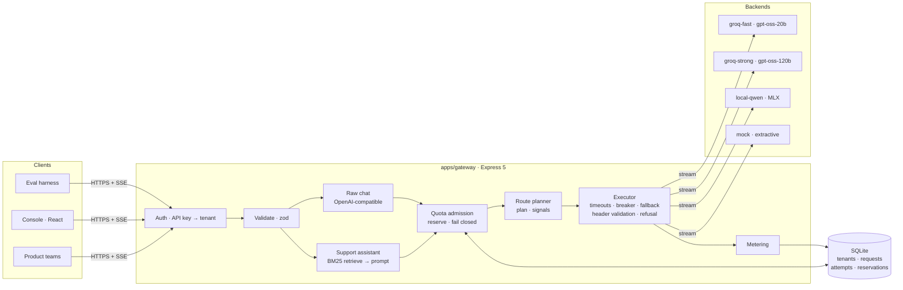
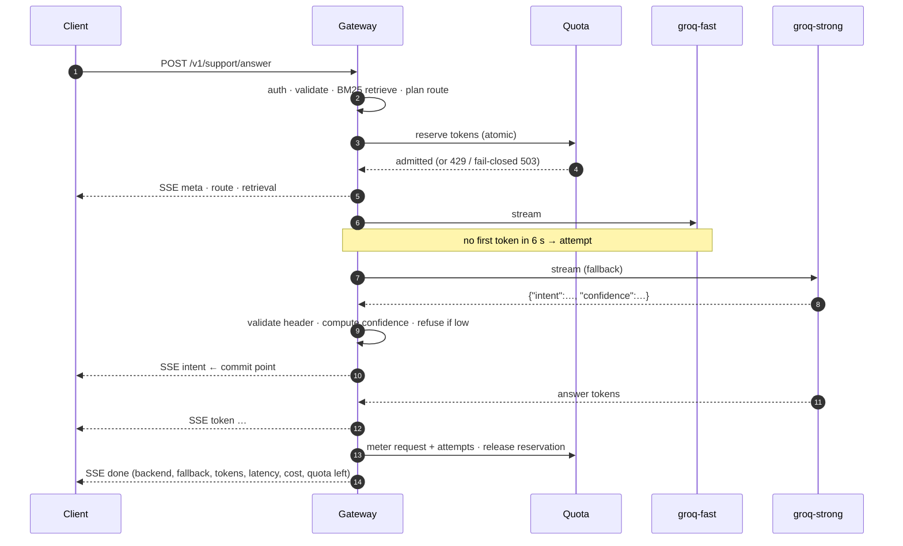
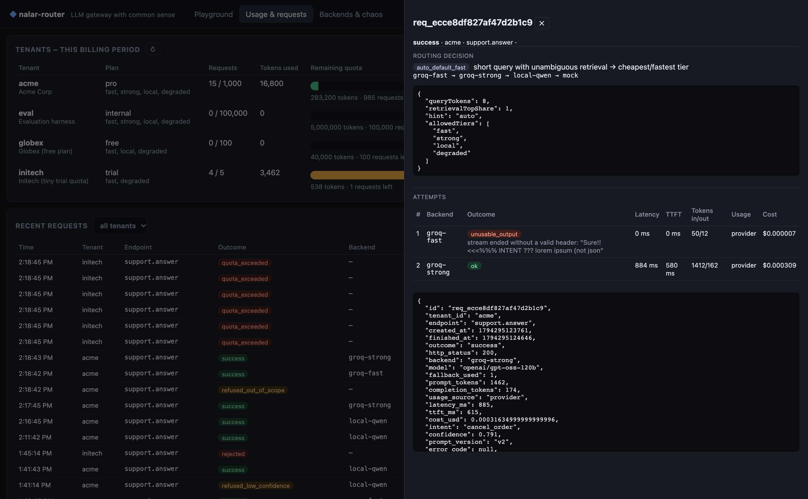

<p align="center">
  
</p>

<p align="center">
  <a href="https://nalar-router.onrender.com"></a>
</p>

<p align="center">
  <a href="https://github.com/fauziridwan1709/nalar-router/actions/workflows/ci.yml"></a>
  
  
  
  
  <br>
  
  
  
  
  
  
  
  
  
</p>

---

**nalar-router** is a small, multi-tenant LLM gateway with one packaged capability on top: a **customer-support assistant**. It answers from a knowledge base, reports the intent it detected, and **refuses rather than guesses** when it isn't sure.

*Nalar* is Indonesian for "reason" or "common sense". On every request the gateway makes two calls with real consequences: which model is worth paying for, and whether to answer at all. Both are made from evidence, recorded, and visible in the console.

> **Try it:** open the [live console](https://nalar-router.onrender.com), pick a tenant, and send a message. You can watch the answer stream in along with the model that served it, whether fallback fired, what was retrieved, the intent and confidence, tokens, latency and cost. On the **Backends & chaos** tab you can break a backend on purpose and watch the router fall back. The service runs on Render's free tier, so the first request after 15 minutes idle takes about a minute.

## Contents

- [Features](#features)
- [Results](#results)
- [Architecture](#architecture)
- [Screenshots](#screenshots)
- [Quick start](#quick-start)
- [Configuration](#configuration)
- [Demo tenants](#demo-tenants)
- [API](#api)
- [Evaluation](#evaluation)
- [Testing](#testing)
- [Deployment](#deployment)
- [Project structure](#project-structure)
- [Design decisions and trade-offs](#design-decisions-and-trade-offs)
- [Dataset and credits](#dataset-and-credits)

## Features

### Gateway

- **Streaming:** Server-Sent Events, per-tenant API keys (stored only as SHA-256 hashes), strict input validation, and stable error codes.
- **Monthly quota per tenant (tokens and requests):** each request pre-authorises its tokens in one atomic transaction, so two concurrent requests can't both spend the last tokens. The quota check fails closed: if it errors, the request gets 503 and no model is called. A request over quota gets 429 with `Retry-After`.
- **Metering:** every request and every backend attempt is stored with the model, tokens (and whether they came from the provider or were estimated), latency, time to first token, estimated cost and outcome.
- **OpenAI-compatible endpoint:** `/v1/chat/completions` for raw use, with an `x_router` block that explains routing.

### Routing and fallback

- **Four backends:** Groq `gpt-oss-20b` (fast), Groq `gpt-oss-120b` (strong), Qwen3.5-4B running locally on Apple MLX, and an extractive fallback that always works.
- **Rules you can defend:** the router respects the tenant's plan, defaults to the cheap model, and escalates to the strong one only for long messages or when retrieval is ambiguous. Each decision is stored as `{rule, reason, chain, signals}`.
- **Fallback:** triggered by an error, no first token within the timeout, the total timeout, or unusable model output. Every attempt is recorded, and a per-backend circuit breaker skips backends that keep failing.
- **One commit point:** fallback can happen only before the first byte reaches the client. Two models' outputs are never spliced into one answer.
- **Fault injection** per backend (`error`, `hang`, `garbage`, extra latency), so fallback can be demonstrated on demand.

### Support assistant

- **Retrieval:** BM25 over 2,160 Bitext KB entries, with typo correction. It reaches 94.7% intent accuracy on its own, and a query takes 0.12 ms.
- **Response:** the answer, the detected intent, the retrieved entries, and a confidence score made of three parts (retrieval vote, lexical coverage, the model's own estimate).
- **Validated output:** the model must emit a JSON header (intent and confidence) before any text streams. If the header is bad, the router falls back to the next backend.
- **Refusal:** short off-topic messages are refused before any model is called ($0). The model can also mark a message `unknown`. Low confidence leads to a hand-off message instead of a guess.

### Console

- **Playground:** live streaming plus an inspector panel showing the routing decision, the fallback trail, intent and confidence, retrieved entries, tokens, latency and cost.
- **Model reasoning:** an optional *thinking* panel streams the model's reasoning (gpt-oss on Groq, Qwen thinking on MLX), kept separate from the answer and labelled per attempt.
- **Step trace:** a timeline of every step with server-side timings: auth and quota, routing, retrieval, scope gate, each attempt, header validation, the commit point, and done.
- **Online/offline labels** on every backend, from live health probes plus the circuit breaker. On the cloud deployment the local model is listed as *offline: runs on a local machine*.
- **Usage:** requests, tokens, cost and remaining quota per tenant, with a drill-down into each request.
- **Backends:** health, circuit breaker state, and fault-injection controls.

## Results

Thirty held-out Bitext cases and five out-of-domain prompts were run end to end through the real gateway. Answer quality was scored by an LLM judge (gpt-oss-120b, scale 1–5) and by ROUGE-L.

| configuration | intent accuracy | judge (1–5) | p50 latency | p50 first token | cost per 1k requests |
|---|---|---|---|---|---|
| **groq-fast · prompt v2** (default) | **100%** | 4.47 | 0.74 s | 0.61 s | **$0.092** |
| groq-strong · prompt v2 | 100% | **4.53** | 0.79 s | 0.65 s | $0.185 |
| groq-fast · prompt v1 | 96.7% | 4.50 | 0.74 s | 0.58 s | $0.078 |
| local-qwen (MLX) · prompt v2 | 100% | 4.43 | 5.27 s | 3.34 s | $0 |

- **Default model:** the 120b model isn't more accurate on this task and costs twice as much. That is the evidence for routing to the fast model by default and escalating only on hard inputs.
- **Refusals:** every configuration refused 5/5 out-of-domain prompts, and none wrongly refused any of the 30 in-domain cases.
- **Hard-case probe:** 8/8 inputs (prompt injection, angry, multi-intent, typo'd, Indonesian) behaved as expected after one fix that the probe itself uncovered.
- **Real fallback:** during the eval Groq slowed down, both Groq backends timed out, and local Qwen served the request. All three attempts are recorded.
- **Token estimates:** my chars/4 estimate runs 6–17% *above* what the provider reports. That is the safe direction for pre-authorising quota.

The full analysis, including what these numbers *don't* show, is in **[docs/REPORT.md](docs/REPORT.md)**. Raw results are in [`tools/eval/results/`](tools/eval/results/).

## Architecture



### Request lifecycle (with fallback)



More diagrams (the routing decision tree and the data model) are in **[docs/ARCHITECTURE.md](docs/ARCHITECTURE.md)**.

## Screenshots

**Playground.** Here `groq-fast` returned malformed output, so the router fell back to `groq-strong`. The inspector shows why.


| Request drill-down: routing decision and attempts | Usage: per-tenant quota and cost |
|---|---|
|  |  |

**Backends and fault injection**


## Quick start

### Prerequisites

- **Node.js ≥ 22.13** (the gateway uses the built-in `node:sqlite`; Node 24 is recommended)
- **A Groq API key** (free at [console.groq.com/keys](https://console.groq.com/keys)). Optional: without one, only the local and mock backends run.
- **Optional:** Apple Silicon with Python 3.10+, for the local MLX model

### 1. Install

```bash
git clone https://github.com/fauziridwan1709/nalar-router.git
cd nalar-router
npm install            # installs every workspace
cp .env.example .env   # then set GROQ_API_KEY
```

### 2. Run

```bash
npm run build          # gateway (tsc) + console (vite)
npm start              # http://localhost:3000 serves the API and the console
```

For development, run these in two terminals:

```bash
npm run dev            # gateway with reload on :3000
npm run dev:console    # Vite on :5173, proxies /v1 /admin /api to :3000
```

### 3. Optional: local model on Apple MLX

```bash
python3 -m venv ~/.venvs/mlx && ~/.venvs/mlx/bin/pip install mlx-lm
~/.venvs/mlx/bin/mlx_lm.server --model mlx-community/Qwen3.5-4B-MLX-4bit --port 8080
echo "LOCAL_LLM_ENABLED=true" >> .env
```

To use Ollama instead, set `LOCAL_LLM_BASE_URL=http://localhost:11434/v1`, `LOCAL_LLM_MODEL=qwen3.5:4b` and `LOCAL_LLM_EXTRA_BODY={"reasoning_effort":"none"}`.

### 4. Try it

```bash
curl -N http://localhost:3000/v1/support/answer \
  -H 'authorization: Bearer sk-acme-demo-7f3a9c' -H 'content-type: application/json' \
  -d '{"message":"how do I cancel order 123?"}'
```

### 5. Optional: rebuild the dataset slices

The generated slices in `data/` are committed. To regenerate them, download the [Bitext CSV](https://huggingface.co/datasets/bitext/Bitext-customer-support-llm-chatbot-training-dataset) to `data/raw/bitext.csv` and run:

```bash
npm run prepare-data   # seeded and deterministic
```

## Configuration

All settings are environment variables, read from `.env` at the repo root (or from the Render dashboard). Defaults live in [`apps/gateway/src/config.ts`](apps/gateway/src/config.ts).

| variable | default | purpose |
|---|---|---|
| `GROQ_API_KEY` | — | Enables `groq-fast` and `groq-strong` |
| `GROQ_FAST_MODEL` / `GROQ_STRONG_MODEL` | `openai/gpt-oss-20b` / `openai/gpt-oss-120b` | Model ids |
| `GROQ_TTFT_TIMEOUT_MS` | `6000` (fast), `8000` (strong) | Fall back if there's no first token by then |
| `LOCAL_LLM_ENABLED` | `false` | Enables `local-qwen` |
| `LOCAL_LLM_BASE_URL` | `http://127.0.0.1:8080/v1` | Any OpenAI-compatible server (MLX, Ollama, vLLM…) |
| `LOCAL_LLM_MODEL` | `mlx-community/Qwen3.5-4B-MLX-4bit` | |
| `LOCAL_LLM_EXTRA_BODY` | `{"chat_template_kwargs":{"enable_thinking":false}}` | Provider-specific request fields |
| `LOCAL_LLM_TTFT_TIMEOUT_MS` | `20000` | |
| `ROUTE_LONG_QUERY_TOKENS` | `60` | Messages longer than this escalate to the strong tier |
| `ROUTE_AMBIGUOUS_VOTE_SHARE` | `0.6` | A top-intent vote below this escalates to the strong tier |
| `BREAKER_FAILURES` / `BREAKER_OPEN_MS` | `3` / `30000` | Circuit breaker |
| `SUPPORT_MIN_COVERAGE` | `0.3` | Lexical coverage below which a short message is refused without a model call |
| `SUPPORT_GATE_MAX_TERMS` | `6` | The coverage check applies only to messages with this many content terms or fewer |
| `SUPPORT_REFUSE_BELOW` | `0.5` | Confidence below which the assistant hands off instead of answering |
| `SUPPORT_PROMPT_VERSION` | `v2` | `v1` (minimal) or `v2` (grounded) |
| `MOCK_TOKEN_DELAY_MS` | `15` | Streaming speed of the mock backend |
| `HEALTH_INTERVAL_MS` | `30000` | How often enabled backends are probed for the online/offline label |
| `DEMO_MODE` | `true` | Exposes the demo keys to the console via `/api/demo-config`. **Turn off outside demos.** |
| `ADMIN_TOKEN` | `admin-demo-token` | Protects `/admin/*` |
| `PORT` | `3000` | |
| `DB_PATH` | `apps/gateway/var/router.db` | SQLite file |
| `ACME_API_KEY`, `GLOBEX_API_KEY`, `INITECH_API_KEY`, `EVAL_API_KEY` | demo values | Override the seeded tenant keys |

## Demo tenants

| tenant | API key | plan → allowed tiers | monthly quota |
|---|---|---|---|
| `acme` | `sk-acme-demo-7f3a9c` | pro → fast, strong, local, degraded | 300k tokens / 1,000 requests |
| `globex` | `sk-globex-demo-41be02` | free → fast, local, degraded | 40k tokens / 100 requests |
| `initech` | `sk-initech-demo-c0ffee` | trial → fast, degraded | **4k tokens / 5 requests**, so you can watch the quota run out |
| `eval` | `sk-eval-demo-e7a1` | internal → all tiers | 5M tokens |

## API

| endpoint | auth | what it does |
|---|---|---|
| `POST /v1/support/answer` | tenant key | The support capability. SSE events: `meta` → `route` → `retrieval` → `attempt`… → `intent` → `token`… → `done` (or `refusal` / `error`). Send `"stream": false` for a single JSON response. |
| `POST /v1/chat/completions` | tenant key | Raw gateway, OpenAI-compatible chunks plus an `x_router` block |
| `GET /v1/backends` | tenant key | Every backend with its online/offline label, where it runs, and whether your plan may use it |
| `GET /v1/usage` | tenant key | The calling tenant's usage and remaining quota |
| `GET /v1/requests/:id` | tenant key | One of the tenant's own requests, with its attempts |
| `GET /admin/usage` · `/admin/requests` · `/admin/requests/:id` | admin token | Usage per tenant; request log with routing decision and attempts |
| `GET /admin/backends` · `PUT /admin/chaos/:backend` · `DELETE /admin/chaos` | admin token | Health, breaker state, fault injection |
| `POST /admin/tenants/:id/reset-quota` | admin token | Demo helper |
| `GET /healthz` | — | Liveness check |

Error codes: `400 invalid_request`, `401 invalid_api_key`, `403 model_not_allowed`, `429 quota_exceeded`, `502 all_backends_failed`, `503 quota_unavailable`. Payload schemas and the full event reference are in **[docs/API.md](docs/API.md)**.

## Evaluation

```bash
npm run retrieval-eval   # LLM-free: BM25 accuracy and refusal-gate calibration on 1,350 held-out rows (~1 s)

npm run eval -- --base http://localhost:3000 \
  --configs groq-fast:v2,groq-strong:v2 --judge groq-strong --delay 17000
  # 30 held-out + 5 out-of-domain cases per config: intent accuracy, ROUGE-L, LLM judge, latency, tokens, cost
  # --delay keeps you under Groq's free tier of 8k tokens/min

npm run probe -w @nalar-router/eval -- --base http://localhost:3000 --model groq-fast
  # 8 adversarial inputs: injection, multi-intent, vague, Indonesian, typos, angry
```

Results are written to `tools/eval/results/<timestamp>.{md,json}`. The eval goes through the real HTTP path, so it measures the whole system (auth, quota, routing, streaming, metering), not just the model.

## Testing

```bash
npm test          # 31 vitest tests, no network (scripted fake backends)
npm run typecheck
```

The tests cover:
- **Request path:** auth, validation, the 403 plan check, and the OpenAI stream format.
- **Quota:** reservation, 429, and the fail-closed 503 when the database is unavailable.
- **Fallback:** on error, on first-token timeout and on unusable output, plus *no* fallback after commit.
- **Circuit breaker.**
- **Support assistant:** header parsing (code fences, `<think>` blocks, percentage confidence), refusals, and routing rules.
- **Reasoning and status:** reasoning is streamed separately from the answer and only when asked for, and offline backends are labelled.

CI runs typecheck, tests, build and the retrieval eval on every push.

## Deployment

The live instance runs on **Render** as a single Node web service that serves both the API and the console.

| setting | value |
|---|---|
| Build command | `npm ci && npm run build` |
| Start command | `npm start` |
| Health check | `/healthz` |
| Environment | `NODE_VERSION=24`, `GROQ_API_KEY`, `DEMO_MODE=true`, `ADMIN_TOKEN` |

`render.yaml` describes the same service as a Render Blueprint. Two caveats on the free plan: the service sleeps after 15 minutes idle, and the disk is ephemeral, so SQLite metering resets when the service redeploys or spins down. For production, the SQL ports straight to Postgres. The local MLX model can't be reached from the cloud, so the deployed instance uses the Groq backends and the extractive fallback.

## Project structure

```
nalar-router/
├── apps/
│   ├── gateway/                 Express API (TypeScript)
│   │   ├── src/
│   │   │   ├── config.ts        every tunable: backends, prices, timeouts, thresholds
│   │   │   ├── http/            routes, auth, SSE sink, OpenAI wire format
│   │   │   ├── router/          policy (route plan) · executor (fallback) · circuit breaker
│   │   │   ├── backends/        OpenAI-compatible client · extractive mock · fault injection
│   │   │   ├── support/         BM25 retrieval · prompts · header parser · assistant
│   │   │   ├── quota.ts         fail-closed admission with token reservations
│   │   │   ├── metering.ts      request and attempt records
│   │   │   └── db.ts            node:sqlite schema and demo tenants
│   │   └── tests/               vitest, no network
│   └── console/                 React 19 + Vite console
├── tools/eval/                  prepare-data · retrieval-eval · eval · probe · results/
├── data/                        KB slice + held-out / OOD / hard eval sets (from Bitext)
├── docs/
│   ├── REPORT.md                technical report: design, results, trade-offs
│   ├── ARCHITECTURE.md          diagrams
│   ├── API.md                   API reference
│   └── assets/                  banner and screenshots
├── .github/workflows/ci.yml
├── render.yaml
└── CLAUDE.md                    notes for coding agents: layout, commands, invariants
```

## Design decisions and trade-offs

The short version is below. The long version is in [docs/REPORT.md](docs/REPORT.md).

- **BM25 instead of embeddings.** Bitext questions are short and templated. BM25 reaches 99.6% recall@8, it's deterministic, and it adds no second model to the request path.
- **The cheap model by default.** The eval shows the 120b model buys almost nothing on this task, at twice the price.
- **Refusal over guessing.** Messages that ask several things at once, vague messages and non-English messages are handed to a human instead of answered. It's a deliberate choice, and multi-intent splitting is listed as the next feature.
- **Fallback only before the first byte.** An honest `partial` error is better than splicing two models' text together.
- **SQLite.** Real transactions keep quota correct and simple. The price is that it's ephemeral on the free host.
- **Cut on purpose:** multi-turn memory, embeddings, per-second rate limits, key rotation, and a production database.

## Dataset and credits

- [Bitext customer-support dataset](https://huggingface.co/datasets/bitext/Bitext-customer-support-llm-chatbot-training-dataset): 26,872 Q&A pairs across 27 intents. This project uses 2,160 entries as the knowledge base and holds out a further 1,380 rows for evaluation.
- Models: [Groq](https://groq.com) (`gpt-oss-20b`, `gpt-oss-120b`), and [Qwen3.5-4B](https://huggingface.co/mlx-community/Qwen3.5-4B-MLX-4bit) via [MLX](https://github.com/ml-explore/mlx).

Built as the Mekari AI Builder take-home assessment.
