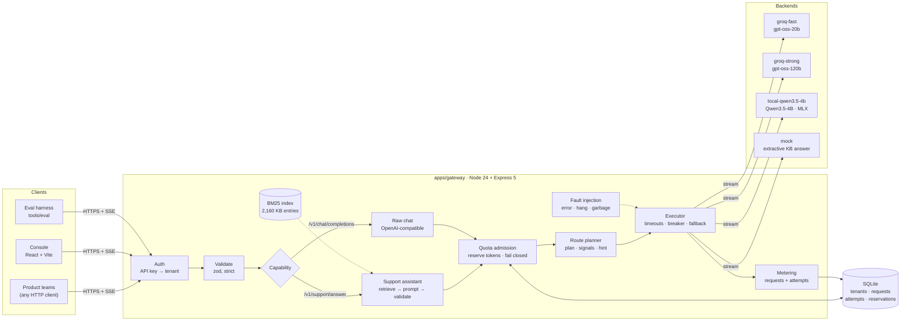
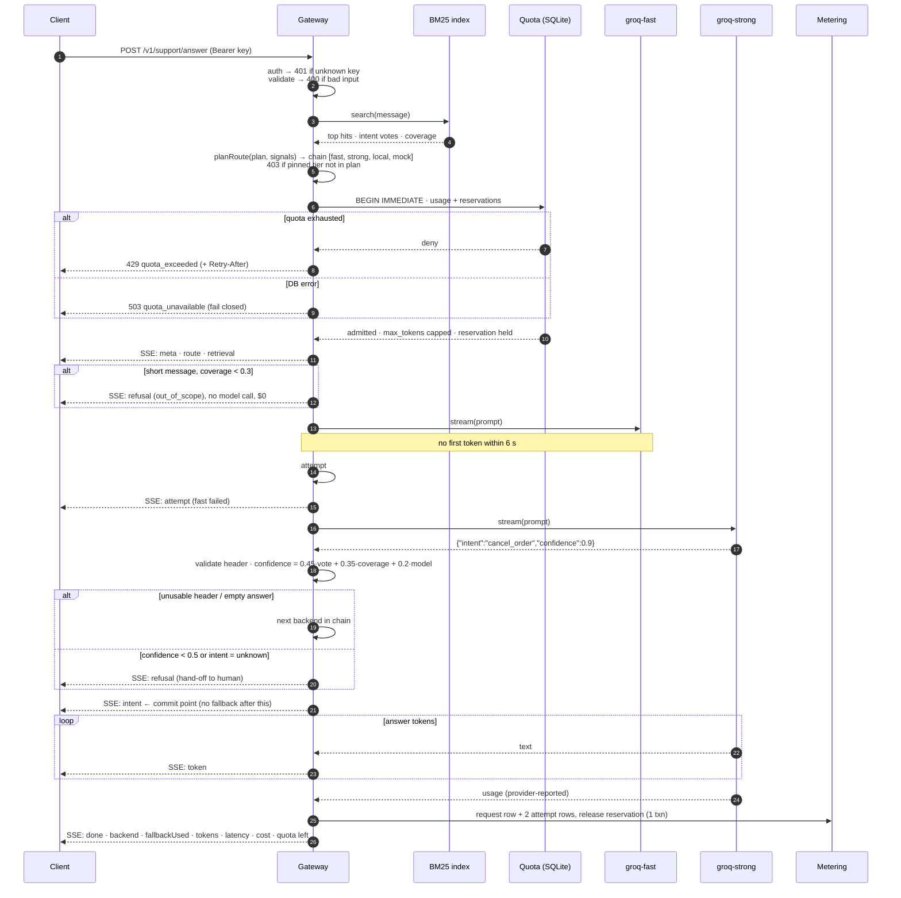
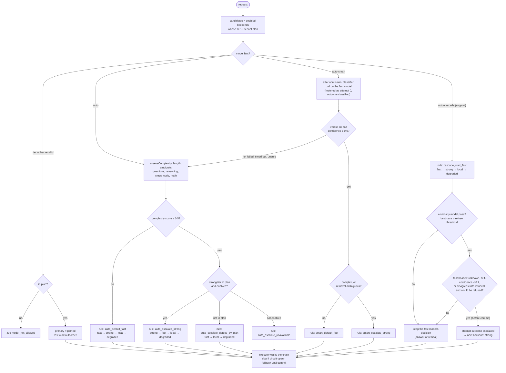
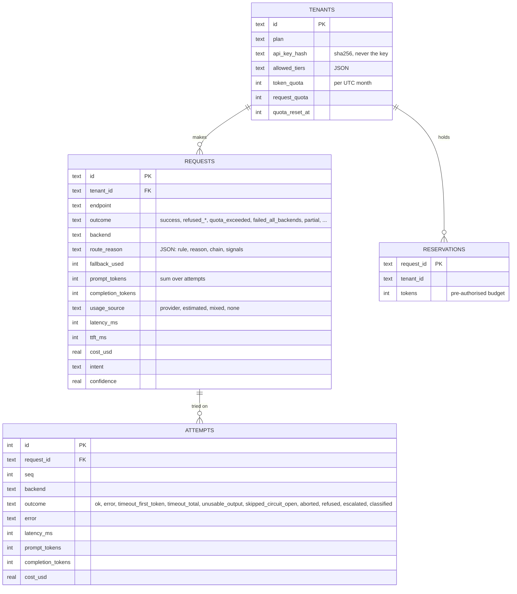
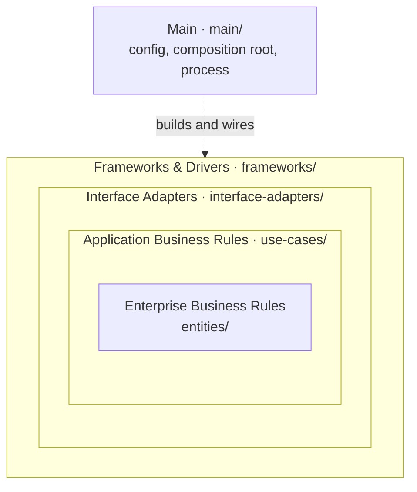
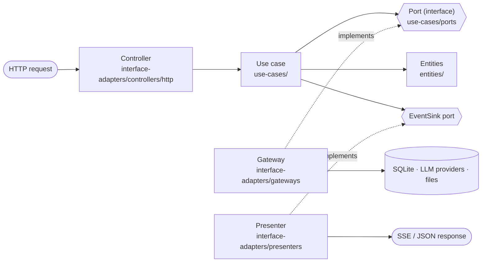
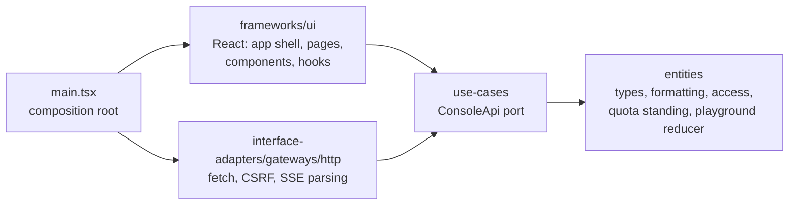

# Architecture

This document has four diagrams, and a section on how the code is layered:

1. [System overview](#1-system-overview): the components and how they connect.
2. [Request lifecycle](#2-request-lifecycle): one support request from start to finish, including fallback.
3. [Routing decision](#3-routing-decision): how the router picks the order of backends.
4. [Data model](#4-data-model): the database tables used for metering and quota.
5. [Code layers](#5-code-layers): the gateway and the console follow Uncle Bob's Clean Architecture; the four circles, the Dependency Rule, and how it is enforced.

GitHub renders these diagrams natively. The design reasoning behind them is in [REPORT.md](REPORT.md).

## 1. System overview

## 2. Request lifecycle

This is one `POST /v1/support/answer` call. In this example the first backend times out and the router falls back to the second.

## 3. Routing decision

## 4. Data model

Quota usage is always calculated from the `REQUESTS` table plus any live `RESERVATIONS`. There is no separate counter that could drift.

## 5. Code layers

Both apps follow Robert C. Martin's **Clean Architecture** ("The Clean Architecture", 2012; *Clean Architecture*, 2017). The folders are named after its four circles, so the rule can be read off the tree. The **Dependency Rule** says source code dependencies point inward only: an inner circle never names anything in an outer one. Each app has a `tests/architecture.test.ts` that fails the build when an import breaks the rule.

Control flows outward and back: a controller calls a use case, the use case calls a port, and a gateway implements that port. The use case only ever sees the port, which is an interface it owns, so the source code dependency still points inward (Dependency Inversion).

### Gateway (`apps/gateway/src`)

| circle | folder | holds | may import |
|---|---|---|---|
| Enterprise Business Rules | `entities/` | pure rules and vocabulary: `planRoute`, `assessComplexity`, the auto-smart classifier prompt and parser, the cascade rule, `CircuitBreaker`, `decideAdmission`, metering `summarize`, PII detectors, BM25 retrieval, the support header parser, placeholders, RBAC grants, API key and session rules, the sign-in `FailureLimiter`, the error catalog | `entities/` only |
| Application Business Rules | `use-cases/` | the interactors: `runCapability` (prepare → admit → run → meter → respond), `prepareSupport`/`runSupport`, `prepareChat`/`runChat`, `executeWithFallback`, `resolveRoute`; console and key management (`signIn`, `scopeTenant`, `redactRequest`, `createApiKey`/`revokeApiKey`, `quotaOverview`, `updatePiiPolicy`, `requestDetailFor`, `setFaultInjection`, …). `ports/` holds the interfaces they call: `Backend`, `EventSink`, `QuotaStore`, `MeteringStore`, `TenantRepository`, `ApiKeyRepository`, `UserDirectory`, `SessionStore`, `PasswordVerifier`, `AuditLog`, `Reporting`, `FaultInjection`, `HealthReader`, `EvalResults`. `deps.ts` gathers them as `AppDeps` / `GatewayDeps`. | `entities/`, `use-cases/` |
| Interface Adapters | `interface-adapters/` | **controllers/http**: the `/v1`, console and admin routes, zod request schemas, session/CSRF/API-key middleware. **presenters**: support SSE, the OpenAI chat wire format (SSE and JSON), the error presenter. **gateways**: SQLite repositories (`sqliteQuotaStore`, `sqliteApiKeyRepository`, `sqliteReporting`, …), the OpenAI-compatible and mock LLM backends, fault injection, health probes, scrypt passwords, eval result files | the three inner folders; Express and `node:sqlite` as **types only** |
| Frameworks & Drivers | `frameworks/` | `web/app.ts` builds the Express app (hardening headers, body parser, mounting the controllers, static console, error presenter); `sqlite/db.ts` opens the database, applies schema and migrations, and seeds demo data | everything except `main/` |
| Main | `main/` | `config.ts` (env → settings), `container.ts` (builds every adapter and wires `GatewayDeps`), `index.ts` (HTTP server, graceful shutdown) | everything |

The architecture test checks three things: no import points outward, `entities/` and `use-cases/` import no Express, zod, SQLite, `node:fs`, `node:http` or `node:net`, and `interface-adapters/` uses Express and `node:sqlite` only through `import type`.

What this buys:
- **Swappable storage and providers.** Use cases run against anything that satisfies a port. Tests use in-memory SQLite and scripted backends. Moving to Postgres means new gateways for the ports, with no change to quota rules, routing or use cases.
- **Thin controllers.** A controller parses, checks the permission and calls one use case. Tenant scoping, redaction, sign-in lockout and key-revocation rights are use cases, so the console routes, the admin routes and the `/v1` routes can't apply them differently.
- **Rules tested as plain functions.** Routing, quota, PII and complexity are unit-tested without HTTP or a database.

Two pragmatic choices, stated plainly:
- Controllers and presenters use Express's `Request`/`Response` types rather than a hand-rolled request model. The Express app itself is created only in `frameworks/web`.
- `GatewayError` (in `entities/errors.ts`) carries an HTTP status. The error catalog is part of the product's contract (`docs/ERRORS.md`), so the status is treated as a business fact, not a delivery detail.

### Console (`apps/console/src`)

The console uses the same circles. Its architecture test also checks that React appears only in `frameworks/` and `main.tsx`, and that only the HTTP gateway calls `fetch` or builds a console API URL.

| circle | folder | holds |
|---|---|---|
| Enterprise Business Rules | `entities/` | the API's types (`models.ts`) and pure rules: number/money formatting, role grants and the page map, quota standing (`levelOf`), backend status, outcome groups, the playground's `applyEvent` reducer and trace text, code snippets. No React. |
| Application Business Rules | `use-cases/` | `ConsoleApi`, the one port: every console operation, typed. The console is mostly view, so this circle is thin. |
| Interface Adapters | `interface-adapters/gateways/http/` | `createHttpConsoleApi()`: fetch with the session cookie and CSRF token, error mapping to `ApiError`, and the playground stream adapter that turns support SSE, OpenAI chunks or a JSON body into one event sequence |
| Frameworks & Drivers | `frameworks/ui/` | React: the app shell, pages, components, styles, and the hooks (`ApiProvider`/`useApi()`, session context, `useMetrics`, `useBackendStatus`) |
| Main | `main.tsx` | builds the HTTP gateway and renders the app with it |

One deliberate deviation: `frameworks/ui` may not import `interface-adapters/`. Martin's rule would allow it, but forbidding it keeps the guarantee that pages reach the gateway only through `useApi()`, so a page can be tested or reused with a fake `ConsoleApi`. The quota rule behind the Quotas page and the notification bell is one function, so the two can't disagree.
