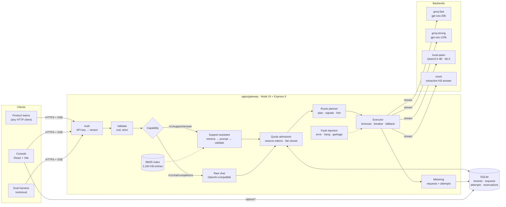
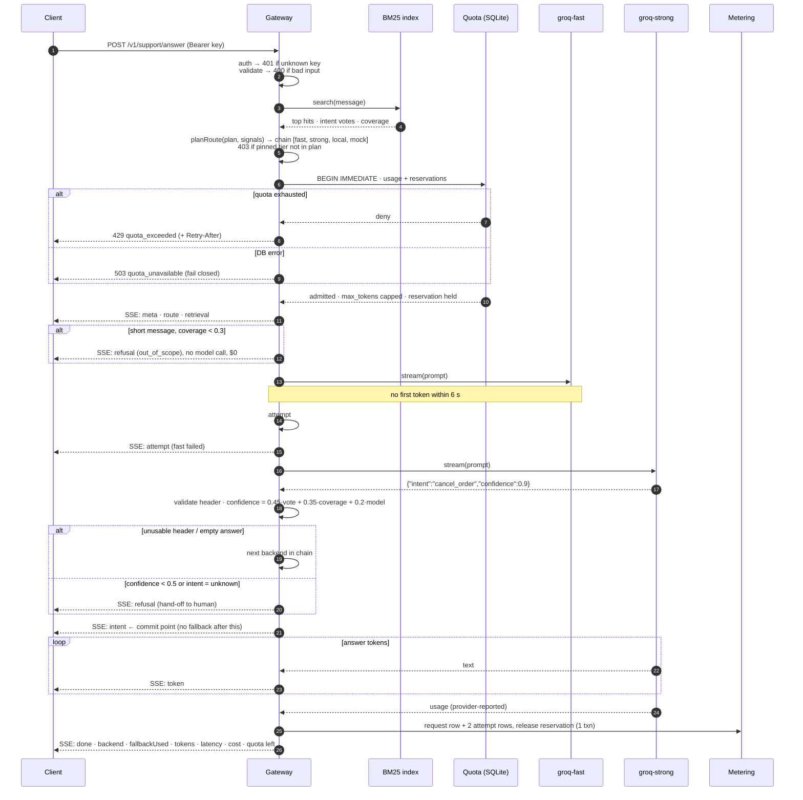
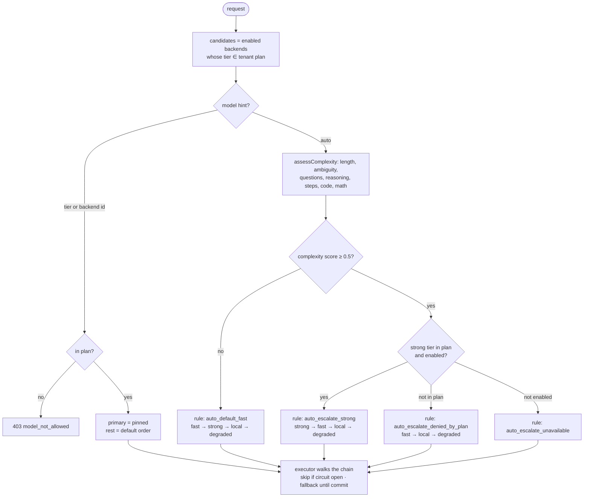
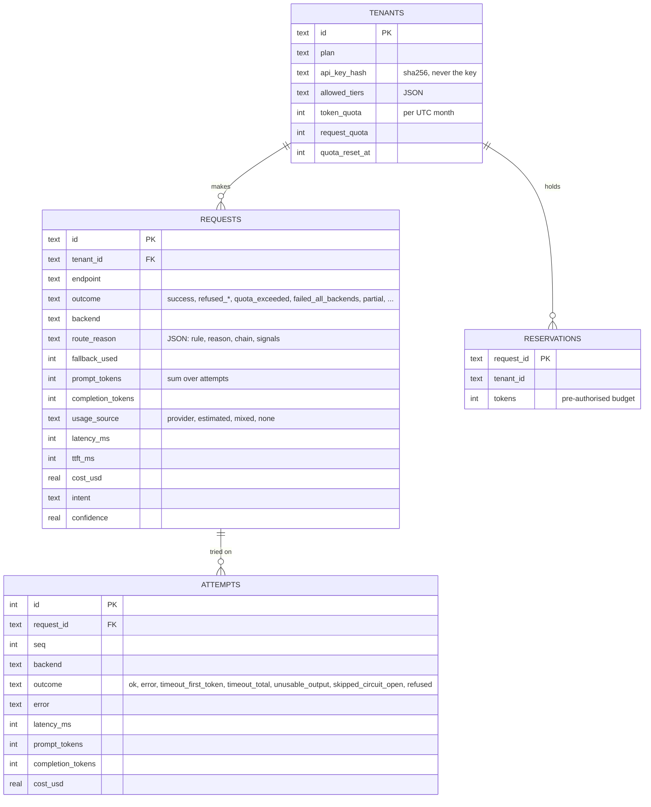
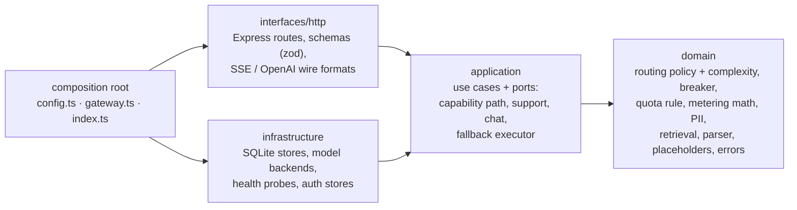

# Architecture

This document has four diagrams, and a section on how the code is layered:

1. [System overview](#1-system-overview): the components and how they connect.
2. [Request lifecycle](#2-request-lifecycle): one support request from start to finish, including fallback.
3. [Routing decision](#3-routing-decision): how the router picks the order of backends.
4. [Data model](#4-data-model): the database tables used for metering and quota.
5. [Code layers](#5-code-layers): the clean-architecture layout of the gateway and its dependency rule.

GitHub renders these diagrams natively. The design reasoning behind them is in [REPORT.md](REPORT.md).

## 1. System overview

## 2. Request lifecycle

This is one `POST /v1/support/answer` call. In this example the first backend times out and the router falls back to the second.

## 3. Routing decision

## 4. Data model

Quota usage is always calculated from the `REQUESTS` table plus any live `RESERVATIONS`. There is no separate counter that could drift.

## 5. Code layers

The gateway (`apps/gateway/src`) follows the clean architecture. Dependencies point inward only, and `tests/architecture.test.ts` fails the build if one doesn't.

| layer | holds | may import |
|---|---|---|
| `domain/` | business rules and vocabulary, pure functions: `planRoute`, `assessComplexity`, `decideAdmission`, `summarize`, PII detectors, BM25, the support header parser, the error catalog | `domain/` only; no Node I/O, Express, SQLite or zod |
| `application/` | use cases: `runCapability` (prepare → admit → run → meter → respond), `prepareSupport`/`runSupport`, `prepareChat`/`runChat`, `executeWithFallback`; and the ports they need: `Backend`, `EventSink`, `QuotaStore`, `MeteringStore`, `AppDeps` | `domain/`, `application/` |
| `infrastructure/` | adapters for the ports: SQLite (`sqliteQuotaStore`, `sqliteMeteringStore`, tenants, keys, sessions, metrics), the OpenAI-compatible and mock backends, chaos, health probes | `domain/`, `application/` |
| `interfaces/http/` | delivery: routes, request schemas, the Express transport for `runCapability`, the support SSE and OpenAI wire formats, the error handler | `domain/`, `application/`; `infrastructure/` only for read-only reporting queries (metrics, logs, keys) that have no rules to put in a use case |
| root | `config.ts` (env → settings), `gateway.ts` (builds the adapters and wires them into `AppDeps`), `index.ts` (HTTP server, shutdown) | everything |

What this buys: the use cases run against any store or provider that satisfies a port (tests use in-memory SQLite and scripted backends). Moving to Postgres means a new `QuotaStore` and `MeteringStore` adapter, with no change to quota rules or use cases. The routing and quota rules are unit-tested as plain functions.
