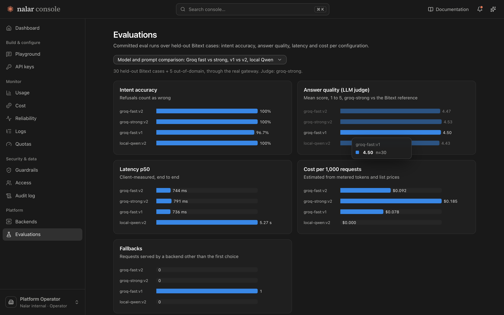

# Evaluation results

This page lists every evaluation that was run, with its headline numbers and a link to the raw output. The raw files live in [`tools/eval/results/`](../tools/eval/results/), and the same runs are charted on the console's **Evaluations** page. How each eval works and what the numbers mean is explained in [REPORT.md §5](REPORT.md#5-evaluation).



## Data

| set | size | source | used for |
|---|---|---|---|
| Knowledge base | 2,160 | Bitext, 80 per intent | retrieval and grounding |
| Held-out eval | 30 | Bitext, one per intent plus 3, never in the KB | the end-to-end eval below |
| Retrieval holdout | 1,350 | Bitext, 50 per intent | LLM-free retrieval accuracy |
| Out-of-domain | 5 | hand-written | refusal checks |
| Hard cases | 8 | hand-written: injection, angry, multi-intent, vague, Indonesian, typos | behavioural probe |

The split is seeded and reproducible: `npm run prepare-data`.

## Runs

### 1. Retrieval only, no LLM ([`retrieval-eval.txt`](../tools/eval/results/retrieval-eval.txt))

| metric | value |
|---|---|
| kNN intent accuracy (1,350 held-out rows) | **94.7%** |
| recall@8 (right intent anywhere in the top 8) | **99.6%** |
| in-domain wrongly refused by the coverage check | 0.4% |
| query latency | 0.14 ms |

### 2. Model and prompt comparison ([`2026-11-10T04-32-12`](../tools/eval/results/2026-11-10T04-32-12.md))

The LLM judge here is gpt-oss-120b.

| config | intent | judge (1–5) | p50 latency | cost per 1k |
|---|---|---|---|---|
| groq-fast, prompt v2 | 100% | 4.47 | 0.74 s | $0.092 |
| groq-strong, prompt v2 | 100% | 4.53 | 0.79 s | $0.185 |
| groq-fast, prompt v1 | 96.7% | 4.50 | 0.74 s | $0.078 |
| local-qwen (MLX), prompt v2 | 100% | 4.43 | 5.27 s | $0 |

The strong model is no more accurate here and costs twice as much. That is why the router defaults to fast and escalates only on hard inputs. During this run one request hit a real Groq slowdown: both Groq models timed out, and local Qwen answered.

### 3. Local model, prompt v1 vs v2 ([`2026-11-10T04-15-13`](../tools/eval/results/2026-11-10T04-15-13.md))

This run has no judge. It also includes the retrieval-only `mock` baseline:
- **Intent accuracy:** local Qwen scored 100% with both prompts; the extractive mock scored 96.7%.
- **Speed:** v1 was faster for local Qwen, 6.7 s vs 8.3 s p50.

### 4. Placeholder rendering ([`2026-11-10T08-11-44`](../tools/eval/results/2026-11-10T08-11-44.md))

| config | answers showing raw `{{…}}` | intent | judge | cost per 1k |
|---|---|---|---|---|
| groq-fast, v2, raw | 15/30 | 100% | 4.60 | $0.093 |
| groq-fast, v3, rendered | **0/30** | 100% | 4.50 | $0.099 |

The judge scores v3 about 0.1 lower, consistently across runs. The caveats are in the report.

### 5. Placeholder rendering, rate-limited re-run ([`2026-11-10T08-35-26`](../tools/eval/results/2026-11-10T08-35-26.md))

This re-run hit Groq's free-tier limit of 8k tokens per minute. Fallback served **59 of 60** in-domain requests with **0 errors**, using groq-strong, local-qwen and the extractive backend. Since different models answered each configuration, this run counts as a resilience result, not a quality comparison.

### 6. Hard-case probe ([`probe-groq-fast.md`](../tools/eval/results/probe-groq-fast.md))

The probe scored **8/8** after one fix, and the probe itself found the problem. On the first run, long in-domain messages were wrongly refused by the coverage check, because the extra words diluted coverage.

### 7. Router modes, live ([`01-24-18`](../tools/eval/results/2026-11-12T01-24-18-router-modes.md), [`01-30-20`](../tools/eval/results/2026-11-12T01-30-20-router-modes.md))

The same 17 support messages (5 held-out, 5 hard cases that expect an answer, 7 routing examples) sent as `auto`, `auto-smart` and `auto-cascade`, through the real gateway on Groq. There is no judge, so this measures what each mode does and what it costs, not answer quality.

The first run used the first versions of both new modes, and it found a flaw in each:
- **auto-cascade** escalated 10 of 17 and changed no outcome. It escalated on combined confidence < 0.75, but that number is 80% retrieval. A fast model that agreed with retrieval already sat within 0.002 of the best score any model could reach.
- **auto-smart** started 9 of 17 on strong, including two plain FAQ questions ("i dont know how to check the early exit penalty": "requires explanation and guidance").

Second run, after both fixes (cascade escalates only on doubt a stronger model could remove; classifier prompt v2):

| mode | success | refused | started on strong | served by strong | cost / 1k req | latency p50 | latency mean |
|---|---|---|---|---|---|---|---|
| `auto` | 11 | 6 | 3 | 3 | $0.136 | 662 ms | 865 ms |
| `auto-smart` | 10 | 7 | 5 | 5 | $0.185 (+36%) | 1100 ms | 1211 ms |
| `auto-cascade` | 11 | 6 | 0 | 7 (all escalated) | $0.194 (+43%) | 849 ms | 962 ms |

- **No mode changed outcomes beyond noise.** The one-request differences come from the fast model itself: `hard-04` was answered by `groq-fast` under `auto` and refused by the same backend under `auto-smart`.
- **auto-cascade's escalations rescued 0 of 6 refusals.** Every refused message (multi-part billing, Indonesian, two problems at once) was refused by the strong model too. The refusal comes from the confidence formula: retrieval cannot pick one intent for a multi-intent message. The model choice doesn't cause it.
- **auto-smart caught what the heuristic can't see.** It escalated the comparison, the two-step request, the calculation, and "my refund never arrived and now I've been charged again", which has no cue words. It kept every held-out case on fast, but on these messages strong didn't change the outcome either.
- No 429s or empty answers in the second run (6 s between requests).

### 8. Classifier prompt, v1 vs v2 ([`classifier-prompts`](../tools/eval/results/2026-11-12-classifier-prompts.md))

The classifier alone, on 42 messages labelled by me (7 complex). v1 caught 5 of 7 and escalated 4 of 35 simple ones; v2 caught 5 of 7 and escalated 0 of 34, with one unparseable reply on the prompt-injection message, where the router fell back to the heuristic as designed. v2 labelled two identical messages differently, so the verdict isn't fully stable even at temperature 0. v2 shipped.

## Reproduce

```bash
npm run retrieval-eval
npm run eval -- --base http://localhost:3000 --configs groq-fast:v2,groq-strong:v2 --judge groq-strong --delay 17000
npm run eval -- --base http://localhost:3000 --configs groq-fast:v2:raw,groq-fast:v3 --judge groq-strong --delay 17000
npm run probe -w @nalar-router/eval -- --base http://localhost:3000 --model groq-fast
npm run router-modes-eval -- --base http://localhost:3000 --delay 6000
```

`--delay` keeps the run under Groq's free tier of 8k tokens per minute. That limit is shared by every caller on the key, including the deployed instance.
